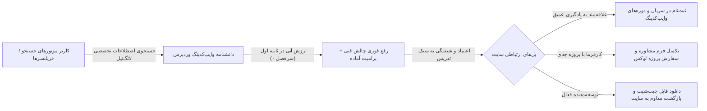
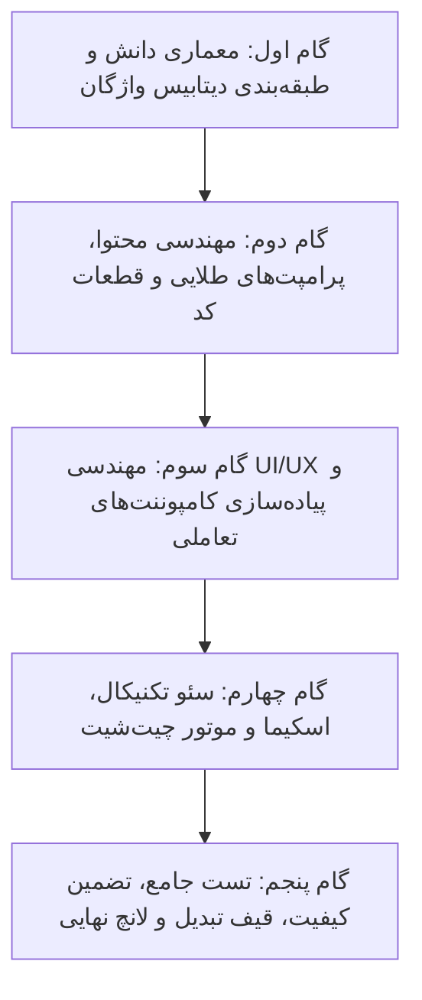

# سند راهبرد جامع، دانشنامه تخصصی و دستورالعمل اجرایی (Master Plan & SOP)
# دانشنامه و دیکشنری جامع وایب‌کدینگ وردپرس (Vibe Coding WordPress Encyclopedia)

> **طراح، استراتژیست و صاحب اثر:** مهندس حسن شاهمرادی  
> **آدرس اختصاصی صفحه:** `hasanshah.ir/vibe-coding/dictionary` (یا `/vibe-coding/glossary`)  
> **دامنه کاربرد:** راهنمای قطعی و عملیاتی برای توسعه‌دهندگان، فریلنسرها و دانشجویانی که قصد دارند با متدولوژی «وایب‌کدینگ» و همراهی ابزارهای هوش مصنوعی (مانند Cursor, Claude Code, GitHub Copilot, Codex)، وب‌سایت‌های فوق‌حرفه‌ای، بدون باگ، لوکس و مقیاس‌پذیر وردپرسی خلق کنند.

---

## فهرست سرفصل‌های سند

1. [مبانی، چشم‌انداز و فلسفه وایب‌کدینگ در وردپرس](#۱-مبانی-چشم‌انداز-و-فلسفه-وایب‌کدینگ-در-وردپرس)
2. [تحلیل تجاری، جایگاه‌سازی برند و سئوی برنامه‌ای (Programmatic SEO)](#۲-تحلیل-تجاری-جایگاه‌سازی-برند-و-سئوی-برنامه‌ای)
3. [معماری داده و ساختار استاندارد هر مدخل (TypeScript Schema)](#۳-معماری-داده-و-ساختار-استاندارد-هر-مدخل)
4. [تشریح ۵ گام اجرایی کلان از ایده تا لانچ پروداکشن](#۴-تشریح-۵-گام-اجرایی-کلان-از-ایده-تا-لانچ-پروداکشن)
   - [گام اول: معماری دانش، طبقه‌بندی ۶ گانه و تدوین دیتابیس واژگان](#گام-اول-معماری-دانش-طبقه‌بندی-۶-گانه-و-تدوین-دیتابیس-واژگان)
   - [گام دوم: مهندسی محتوا، پرامپت‌های طلایی و قطعات تست‌شده کد](#گام-دوم-مهندسی-محتوا-پرامپت‌های-طلایی-و-قطعات-تست‌شده-کد)
   - [گام سوم: مهندسی رابط کاربری (UI/UX) و پیاده‌سازی کامپوننت‌های تعاملی](#گام-سوم-مهندسی-رابط-کاربری-uiux-و-پیاده‌سازی-کامپوننت‌های-تعاملی)
   - [گام چهارم: سئو تکنیکال، اسکیماهای گوگل و موتور خروجی چیت‌شیت](#گام-چهارم-سئو-تکنیکال-اسکیماهای-گوگل-و-موتور-خروجی-چیت‌شیت)
   - [گام پنجم: تست جامع، کنترل کیفیت، یکپارچه‌سازی با قیف فروش و لانچ رسمی](#گام-پنجم-تست-جامع-کنترل-کیفیت-یکپارچه‌سازی-با-قیف-فروش-و-لانچ-رسمی)
5. [بانک تفصیلی واژگان دانشنامه (فهرست جامع ۱۲۰ اصطلاح در ۶ حوزه)](#۵-بانک-تفصیلی-واژگان-دانشنامه)
6. [معماری کامپوننت‌های فرانت‌اند و تعاملات کاربری (Component Architecture)](#۶-معماری-کامپوننت‌های-فرانت‌اند-و-تعاملات-کاربری)
7. [انطباق با قوانین سازمانی مخزن (AGENTS.md Compliance Checklist)](#۷-انطباق-با-قوانین-سازمانی-مخزن)
8. [ماتریس ارزیابی و ضوابط قبولی نهایی (Definition of Done)](#۸-ماتریس-ارزیابی-و-ضوابط-قبولی-نهایی)

---

## ۱. مبانی، چشم‌انداز و فلسفه وایب‌کدینگ در وردپرس

### ۱.۱. تعریف مهندسی وایب‌کدینگ در اکوسیستم حسن شاهمرادی
در ادبیات رایج اینترنت، «وایب‌کدینگ» به اشتباه به عنوان کدنویسی بدون دانش قبلی یا رها کردن فرآیند ساخت به دست چت‌بات‌ها شناخته می‌شود. این نگاه غلط همواره به بن‌بست می‌انجامد:
- کدهایی که در ظاهر کار می‌کنند ولی نشت حافظه دارند.
- سایت‌هایی که در اولین به‌روزرسانی قالب یا هسته، دچار خطای مرگبار (White Screen of Death) می‌شوند.
- فرم‌هایی که حفره‌های امنیتی وحشتناک (مانند عدم استفاده از Nonce و تزریق SQL) دارند.

> **تز اختصاصی حسن شاهمرادی برای وایب‌کدینگ وردپرس:**  
> «وایب‌کدینگ در بالاترین سطح خود، یعنی **مهندس ارشد بودن در هدایت ارتشی از هوش مصنوعی**. یک وایب‌کدر موفق کسی است که الفبا، استخوان‌بندی و معماری وب را عمیقاً درک کرده است؛ او کد را تایپ نمی‌کند، بلکه معماری را دیکته می‌کند و با پرامپت‌های دقیق، پاسخ‌های هوش مصنوعی را در چارچوب استانداردهای مهندسی مهار می‌سازد.»

### ۱.۲. چرا ترکیب وایب‌کدینگ با وردپرس؟
وردپرس بزرگ‌ترین سیستم مدیریت محتوای جهان است که بیش از ۴۰ درصد وب را نیرو می‌بخشد. اما توسعه سنتی وردپرس با صفحه‌سازهای سنگین (مانند المنتور) به سایت‌های کند، سنگین و پر از افزونه‌های متداخل منجر شده است.  
از سوی دیگر، توسعه مدرن کدنویسی دستی قالب‌ها و بلاک‌های گوتنبرگ نیازمند تسلط همزمان به PHP، ری‌اکت، جاوااسکریپت مدرن و وب‌پک است که ماه‌ها زمان می‌برد.  
**وایب‌کدینگ دقیقاً این شکاف تاریخی را پر می‌کند:**  
یک طراح مسلط به واژگان تخصصی، با استفاده از ادیتورهای هوش مصنوعی می‌تواند یک قالب اختصاصی، سبک، با سرعت ۱۰۰ در لایت‌هاوس و با بلاک‌های بومی گوتنبرگ را در عرض چند روز تولید کند؛ به این شرط که بداند از چه ابزار، چه هوک و چه ساختار دیتابیسی باید استفاده کند.

---

## ۲. تحلیل تجاری، جایگاه‌سازی برند و سئوی برنامه‌ای



### ۲.۱. تسخیر سئوی موضوعی و کلمات کلیدی دم‌دراز (Long-tail Keywords)
- روزانه هزاران جستجو با عناوینی نظیر:
  - *«ترنزینت در وردپرس چیست و چه کاربردی دارد؟»*
  - *«نحوه نوشتن پرامپت برای ساخت بلاک گوتنبرگ با ری‌اکت»*
  - *«تفاوت Action Hook و Filter Hook به زبان ساده»*
  - *«چگونه با هوش مصنوعی قالب وردپرس بدون المنتور بسازیم؟»*
  - *«دستورات ضروری WP-CLI برای رفع ارورهای دیتابیس»*
- صفحات دانشنامه‌ای با معماری مناسب، برای صدها عبارت کلیدی بدون نیاز به خرید بک‌لینک‌های مصنوعی، به لینک ۱ نتایج گوگل صعود می‌کنند.

### ۲.۲. مرجعیت علمی و تبدیل کاربر به هوادار (Topical Authority & Retention)
این دانشنامه صرفاً یک متن بلاگ نیست؛ یک **ابزار وب (Web Tool)** تعاملی است. توسعه‌دهندگان آن را به مرورگر خود پین (Pin Tab) یا بوکمارک می‌کنند تا هنگام کار با ادیتورهای AI از آن کمک بگیرند. هر بازگشت مجدد کاربر، سیگنال تعاملی فوق‌العاده‌ای به الگوریتم‌های گوگل مخابره می‌کند.

### ۲.۳. تبدیل مستقیم به لید و فروش دوره
- در انتهای هر دسته از اصطلاحات، یک بنر بومی و غیرمزاحم تعبیه می‌شود که نشان می‌دهد چطور تمام این اصطلاحات در **«سریال عملی وایب‌کدینگ حسن شاهمرادی»** به صورت پروژه واقعی به هم متصل می‌شوند.
- همچنین برای کارفرمایان، حضور این پایگاه دانش اثبات می‌کند که تیم حسن شاهمرادی، وب‌سایت‌های وردپرسی را با کدنویسی تمیز، مدرن و اختصاصی پیاده می‌کند و وابستگی به افزونه‌های آماده و کند ندارد.

---

## ۳. معماری داده و ساختار استاندارد هر مدخل (TypeScript Schema)

تمام واژگان دانشنامه در فایل‌های تایپ‌اسکریپت ساختاریافته در مسیر `app/vibe-coding/dictionary/data/` ذخیره می‌شوند. ساختار داده تایپ‌شده به شکل زیر تضمین می‌کند که هیچ فیلد حیاتی از قلم نیفتد:

```typescript
export type TermCategory = 
  | 'vibe-ai'        // هوش مصنوعی و متودولوژی وایب‌کدینگ
  | 'ui-ux'          // طراحی، تجربه و رابط کاربری
  | 'frontend'       // فرانت‌اند مدرن، تیل‌ویند و گوتنبرگ
  | 'wp-core'        // هسته وردپرس، معماری بک‌اند و PHP
  | 'database-api'   // دیتابیس، کوئری‌ها و وب‌سرویس‌های REST
  | 'devops-server'; // سرور، هاست، دیپلوی، CLI و بهینه‌سازی

export type DifficultyLevel = 'beginner' | 'intermediate' | 'advanced';

export interface CodeSnippet {
  language: 'php' | 'javascript' | 'bash' | 'json' | 'css' | 'sql';
  code: string;
  description: string;
  runContext?: string; // مثلاً: functions.php یا wp-config.php یا ترمینال سرور
}

export interface EncyclopediaTerm {
  id: string;                     // شناسه یکتای لاتین برای URL و انکر (مثال: 'transient-cache')
  termEn: string;                 // عنوان استاندارد انگلیسی (مثال: 'Transients API')
  termFa: string;                 // عنوان یا ترجمه مصطلح فارسی (مثال: 'کش موقت دیتابیس / ترنزینت')
  category: TermCategory;         // حوزه تخصصی ۶ گانه
  level: DifficultyLevel;         // سطح سختی مفهوم
  phonetic?: string;              // راهنمای تلفظ انگلیسی با خط فارسی یا فونتیک
  tags: string[];                 // برچسب‌های ارتباطی و خوشه‌بندی
  
  // لایه‌های محتوایی ۴ گانه
  shortDefinition: string;        // تعریف سریع و روشن در ۱ یا ۲ جمله (برای اسنیپت و لودینگ‌های سریع)
  deepExplanation: string;        // تحلیل عمیق سازوکار در وردپرس و سناریوهای واقعی
  vibeCodingImpact: string;       // نگاه اختصاصی وایب‌کدینگ: عواقب ندانستن اصطلاح و خطاهای رایج AI
  goldenPrompt: string;           // پرامپت مهندسی‌شده و آماده کپی برای Cursor Composer یا Claude
  codeSnippet?: CodeSnippet;      // نمونه کد اعتبارسنجی‌شده یا دستور خط فرمان
  
  // روابط و سئو
  relatedTermIds: string[];       // شناسه‌های اصطلاحات هم‌خانواده برای گراف دانش
  seoKeywords: string[];          // واژگان جستجوی سرچ داخلی و مترادف‌های فارسی/انگلیسی
}
```

---

## ۴. تشریح ۵ گام اجرایی کلان از ایده تا لانچ پروداکشن



---

### گام اول: معماری دانش، طبقه‌بندی ۶ گانه و تدوین دیتابیس واژگان

**هدف گام:** ایجاد زیرساخت داده، استخراج کامل اصطلاحات در ۶ حوزه تخصصی و یکپارچه‌سازی متادیتای سیستم.

#### اقدامات اجرایی گام اول:
1. **ایجاد پوشه‌های ماژولار در پروژه:**
   - مسیر `app/vibe-coding/dictionary/`
   - مسیر `app/vibe-coding/dictionary/data/` جهت نگه‌داری دیتابیس‌های تفکیک‌شده موضوعی:
     - `ai-terms.ts`
     - `uiux-terms.ts`
     - `frontend-terms.ts`
     - `wpcore-terms.ts`
     - `database-terms.ts`
     - `devops-terms.ts`
     - `index.ts` (تجمیع و اکسپورت یکپارچه با توابع کمکی جستجو و فیلتر).
2. **کدگذاری و دسته‌بندی موضوعی ۶ گانه:**
   - تعیین رنگ تم، آیکون و بج اختصاصی برای هر دسته متناسب با دیزاین سیستم لوکس و طلایی حسن شاهمرادی.
3. **تدوین مشخصات الفبایی دوگانه:**
   - ایندکس الفبایی انگلیسی (`A` تا `Z`) برای واژگان تخصصی.
   - ایندکس الفبایی فارسی (`الف` تا `ی`) برای معادل‌های مصطلح در وب فارسی.
4. **تأمین اولیه دیتابیس با بیش از ۱۰۰ اصطلاح شناسایی‌شده** (مطابق بخش ۵ این سند).

---

### گام دوم: مهندسی محتوا، پرامپت‌های طلایی و قطعات تست‌شده کد

**هدف گام:** نگارش محتوای ناب و عاری از کلیشه‌های هوش مصنوعی برای هر اصطلاح؛ هر کارت باید یک ارزش مهندسی ملموس ارائه کند.

#### الزامات محتوایی ۴ لایه برای هر مدخل:
1. **لایه اول (تعریف مفهومی روان):** حذف واژگان غیرشفاف و ارائه یک تصویر ذهنی روشن (Mental Model).
2. **لایه دوم (هشدار وایب‌کدینگ - The AI Trap):** توضیح اینکه اگر وایب‌کدر این اصطلاح را نداند، مدل‌های هوش مصنوعی معمولاً چه باگ یا توهمی تولید می‌کنند (Hallucination Alert).
3. **لایه سوم (پرامپت مهندسی طلایی):** یک دستور ساخت‌یافته حاوی نقش، زمینه، شروط منفی (Negative Constraints) و متغیرهای جایگزین (`[نام متغیر]`) که کاربر با یک کلیک کپی کرده و به ادیتور بفرستد.
4. **لایه چهارم (تکه کد اجرایی استاندارد):** کد خالص، استانداردسازی‌شده بر اساس سنجه‌های امنیتی و با کامنت‌های آموزشی.

#### پیاده‌سازی سرفصل شماره ۰ الزامی (Quick Access Tools):
بر اساس استاندارد مندرج در `AGENTS.md`، ابتدای صفحه دانشنامه باید شامل ابزارهای آنلاین فوری باشد:
- **تست‌کننده آنلاین هوک‌های وردپرس:** لینک مستقیم به مستندات رسمی Developer.wordpress.org.
- **تولیدکننده Nonce و شبیه‌ساز امنیتی:** ابزارهای تست درخواست‌های ایجکس.
- **ابزار ساخت متادیتای `block.json`:** ژنراتور آنلاین برای ساخت بلاک‌های گوتنبرگ.
- **تست کدهای باینری دیتابیس:** ابزار تست جستجو و جایگزینی عبارات سریال‌شده دیتابیس وردپرس.
- **تست‌کننده سرعت Core Web Vitals:** لینک به PageSpeed Insights و GTmetrix.

---

### گام سوم: مهندسی رابط کاربری (UI/UX) و پیاده‌سازی کامپوننت‌های تعاملی

**هدف گام:** خلق یک اینترفیس نسل جدید با بالاترین سرعت پاسخ‌دهی، جلوه‌های بصری خیره‌کننده و ارگونومی مدرن ابزارهای توسعه.

#### کامپوننت‌های محوری رابط کاربری:
1. **هدر لوکس با پس‌زمینه ذره‌ای و گرادیان طلایی (`DictionaryHero.tsx`):**
   - نمایش آمار زنده تعداد اصطلاحات، تعداد دسته‌ها و میانگین سرعت لود.
2. **پالت فرمان و سرچ کیبورد (`Cmd + K`):**
   - جستجوی آنی همزمان روی عناوین انگلیسی، فارسی و متن تعاریف با الگوریتم فازی و بدون تاخیر.
3. **نوار دسته‌بندی با وضعیت فعال درخشان (Glassmorphic Category Tabs):**
   - دکمه‌های شیشه‌ای تیره با حاشیه‌های طلایی و نمایش تعداد اصطلاح در هر دسته.
4. **فیلتر سه‌گانه سطوح دشواری:**
   - مبتدی (سبز زمردی)، متوسط (زرد کهربایی)، پیشرفته (قرمز یاقوتی).
5. **کارت‌های تعاملی با زبانه اختصاصی (`TermCard.tsx`):**
   - تب ۱: تحلیل مفهومی و سناریوی وایب‌کدینگ.
   - تب ۲: پرامپت آماده با دکمه کپی فوری و انیمیشن موفقیت‌آمیز.
   - تب ۳: ویرایشگر کد کوچک با تم تیره و قابلیت هایلایت سینتکس.
6. **اشتراک‌گذاری و دیپ‌لینکینگ:**
   - هر کارت دارای یک آیکون پیوند مستقیم است که با کلیک، هش URL کپی شده و کاربر مستقیماً به آن کارت اسکرول نرم می‌کند.
7. **سیستم بوکمارک محلی (Local Favorites / Cheat Sheet):**
   - دکمه نشان‌کردن اصطلاحات برای ذخیره در `localStorage` و فیلتر سریع «اصطلاحات منتخب من».

---

### گام چهارم: سئو تکنیکال، اسکیماهای گوگل و موتور خروجی چیت‌شیت

**هدف گام:** کسب رتبه‌های نخست گوگل، تضمین ایندکس فوری و تبدیل دانش صفحه به فایل‌های قابل دانلود برای ادیتورها.

#### اقدامات اجرایی گام چهارم:
1. **پیاده‌سازی متادیتا و اسکیماهای JSON-LD:**
   - استفاده از تایپ استاندارد `DefinedTermSet` و برای هر اصطلاح `DefinedTerm`.
   - اسکیماهای پیونددهنده `BreadcrumbList` و `TechArticle`.
   - ایجاد تگ‌های OpenGraph و تصویر پیش‌نمایش بهینه (`og:image`).
2. **موتور خروجی فایل قوانین (`.cursorrules` / Markdown Export):**
   - دکمه‌ای جذاب با عنوان **«دانلود قوانین هوش مصنوعی برای پروژه شما (.cursorrules)»**.
   - این موتور، اصطلاحات و شروط کلیدی را در قالب یک فایل دستورالعمل هوش مصنوعی کامپایل کرده و به کاربر دانلود می‌دهد تا مستقیماً در پوشه پروژه وردپرس خود پیست کند!
3. **ثبت در نقشه سایت دینامیک (`sitemap.ts`):**
   - اعلام آدرس به گوگل با اولویت بالای `0.9` و فرکانس آپدیت هفتگی.
4. **بهینه‌سازی لایت‌هاوس:**
   - استفاده از فونت‌های محلی، بهینه‌سازی CSS و عدم بارگذاری کتابخانه‌های حجیم بیرونی.

---

### گام پنجم: تست جامع، کنترل کیفیت، یکپارچه‌سازی با قیف فروش و لانچ رسمی

**هدف گام:** اطمینان از سلامت صددرصدی کدها، عملکرد بی‌نقص روی موبایل و فعال‌سازی کامل جریان جذب لید و فروش دوره‌ها.

#### چک‌لیست اقدامات گام پنجم:
1. **تست بیلد نهایی تایپ‌اسکریپت (`npm run build`):**
   - بیلد با موفقیت کامل و بدون کوچک‌ترین تایپ ارور (Exit code 0).
2. **تست در ابعاد مختلف نمایشگرها:**
   - مانیتور ۴K، لپ‌تاپ ۱۳ اینچ، تبلت آیپد و گوشی‌های آیفون و اندروید.
3. **اتصال به قیف فروش و تماس:**
   - درج کارت اختصاصی دعوت به **«دورهمی و کارگاه حضوری وایب‌کدینگ در تهران»**.
   - ارجاع به سریال آنلاین وایب‌کدینگ (`/vibe-coding/series/`).
   - فرم مشاوره طراحی سایت اختصاصی برای مشتریان سازمانی.
4. **انتشار، سابمیت در سرچ کنسول و مانیتورینگ:**
   - تست ابزار URL Inspection در گوگل سرچ کنسول.
   - مانیتور ترافیک و بازخورد کاربران برای افزودن مداوم اصطلاحات جدید.

---

## ۵. بانک تفصیلی واژگان دانشنامه

در ادامه، ۱۲۰ اصطلاح بنیادین در ۶ حوزه تخصصی آورده شده است که پایگاه داده اولیه دانشنامه را تشکیل می‌دهند:

### حوزه ۱: هوش مصنوعی و متودولوژی وایب‌کدینگ (AI & Vibe Coding Core)

1. **Context Window (پنجره بافت):** ظرفیت پردازش حافظه مدل که تعیین می‌کند تا چه حجمی از کدهای قالب وردپرس را می‌توانید به صورت همزمان به هوش مصنوعی پاس بدهید.
2. **System Prompt (پرامپت سیستمی):** دستورالعمل‌های مادر و ریشه‌ای که لحن، محدودیت‌ها و استانداردهای کدنویسی تمیز را به ادیتور AI تحمیل می‌کنند.
3. **`.cursorrules` File:** فایل پیکربندی ادیتور Cursor برای شناخت قوانین اختصاصی وردپرس (مانند رعایت پیشوند توابع و هوک‌های امنیتی).
4. **Composer & Agentic Mode:** حالت عامل هوشمند در Cursor که قابلیت ساخت چندین فایل، اجرای تست و عیب‌یابی چندمرحله‌ای را فراهم می‌کند.
5. **Hallucination Guard (مهار توهم):** استراتژی‌های پرامپت‌نویسی برای جلوگیری از اختراع توابع غیرواقعی یا منسوخ‌شده در وردپرس توسط مدل.
6. **PRD-Driven Coding (توسعه مبتنی بر سند محصول):** نوشتن سند دقیق قابلیت‌ها قبل از پرامپت زدن، برای جلوگیری از کدنویسی بی‌هدف.
7. **Diff Review (بررسی تغییرات خط‌به‌خط):** مهارت ارزیابی تک‌تک خطوط کد تغییریافته توسط هوش مصنوعی قبل از تأیید نهایی (Accept).
8. **Token Budget Management:** بهینه‌سازی حجم فایل‌ها و خلاصه‌سازی داده‌ها برای صرفه‌جویی در سقف توکن‌های اشتراک API.
9. **Few-Shot Prompting:** روش تزریق چند نمونه کد ایده‌آل و واقعی به هوش مصنوعی برای تثبیت سبک برنامه‌نویسی مطلوب در پروژه.
10. **Chain-of-Thought (زنجیره استدلال):** الزام هوش مصنوعی به توضیح گام‌به‌گام منطق برنامه قبل از تولید کد در مسائل پیچیده پایگاه داده.
11. **Rollback Strategy with Git:** استفاده از کامیت‌های ریز (Micro-commits) با گیت برای بازگشت فوری در صورت انحراف هوش مصنوعی.
12. **Negative Constraints (محدودیت‌های سلبی):** مشخص کردن دقیق کارهایی که AI حق ندارد انجام دهد (مانند: «از توابع متفرقه جی‌کوئری استفاده نکن»).
13. **Claude Code CLI:** ابزار خط فرمان پیشرفته برای بازنویسی، تحلیل کل ریپازیتوری و اجرای وظایف سنگین توسعه وردپرس در ترمینال.
14. **Windsurf Cascade:** موتور جریان کدنویسی هوشمند برای درک تغییرات پیوسته در سراسر فایل‌های پوسته وردپرس.
15. **Spec-Driven Architecture:** متدولوژی ساخت ماژول‌های مستقل بر اساس تعاریف دقیق اینترفیس‌ها قبل از پیاده‌سازی جزئیات.
16. **AI Iterative Refinement:** بازخورد دادن چرخه‌ای به مدل برای ارتقای تدریجی خوانایی، امنیت و عملکرد کد اولیه.
17. **Semantic Code Search (جستجوی برداری کد):** جستجوی مفهومی در توابع وردپرس به جای تطابق متنی ساده.
18. **Prompt Template Variables:** قالب‌بندی پارامتریک پرامپت‌ها برای استفاده مجدد در ساخت CPTها، تاکسونومی‌ها و فرم‌ها.
19. **Code Review Prompting:** پرامپت‌های تخصصی برای اسکن امنیتی و بهینه‌سازی کدهای تولیدشده توسط مدل دوم.
20. **Legacy Code Modernization:** متدهای پرامپت‌نویسی برای بازنویسی کدهای قدیمی PHP 5.6 وردپرس به معماری مدرن PHP 8.2+.

---

### حوزه ۲: طراحی، رابط و تجربه کاربری (UI/UX & Design Systems)

21. **Design Tokens (توکن‌های دیزاین):** کوچک‌ترین واحدهای طراحی (رنگ، سایه، شعاع گوشه، فونت) که پل ارتباطی فیگما و تیل‌ویند هستند.
22. **Visual Hierarchy (سلسله‌مراتب بصری):** اولویت‌بندی نگاه مخاطب با تنظیم کنتراست، مقیاس اندازه و فضای خالی.
23. **Micro-interactions:** انیمیشن‌های مینیمال هاور، کلیک و بارگذاری که حس یک محصول زنده و لوکس را القا می‌کنند.
24. **F-Shape Reading Pattern:** الگوی حرکتی چشم کاربران وب در صفحات متنی و مقالات برای چیدمان بهینه تیترها.
25. **Z-Shape Pattern:** الگوی بصری فرود چشم در لندینگ‌پیج‌ها برای چیدمان لوگو، شعار و دکمه‌های اقدام به عمل (CTA).
26. **WCAG 2.1 Accessibility:** استاندارد بین‌المللی دسترسی‌پذیری وب برای معلولین، کنتراست رنگ و قابلیت ناوبری با کیبورد.
27. **Touch Target Guidelines:** رعایت حداقل مساحت ۴۸ در ۴۸ پیکسل برای تمام المان‌های تعاملی در نسخه موبایل.
28. **Skeleton Loading Screens:** استخوان‌بندی خاکستری لود محتوا برای کاهش حس معطلی کاربر در هنگام دریافت داده از API.
29. **Cumulative Layout Shift (CLS):** جلوگیری از پرش‌های ناگهانی المان‌های صفحه در زمان لود تصاویر، فونت‌ها و بنرها.
30. **Atomic Design System:** ساختاردهی کامپوننت‌ها به ۵ لایه: اتم، مولکول، ارگانیسم، تمپلیت و صفحه.
31. **Fluid Typography (clamp):** مقیاس‌پذیری خودکار اندازه فونت متناسب با عرض صفحه نمایشگر بدون نیاز به انبوه مدیاکوئری‌ها.
32. **Dark Mode Theme Switching:** طراحی دوگانه المان‌ها با مدیریت متغیرهای CSS و جلوگیری از چشمک‌زدن رنگ در لود اول (FOUC).
33. **Empty States:** طراحی صفحات و بخش‌هایی که هنوز دیتایی در آن‌ها ثبت نشده (مانند سبد خرید خالی یا نتایج جستجوی صفر).
34. **Error Boundary UX:** طراحی صفحات خطای کاربری دوستانه به جای نمایش پیام‌های خام و ترسناک سیستمی.
35. **Form Field Micro-copy:** راهنماها و پیام‌های خطای اعتبارسنجی شفاف و مختصر در فرم‌های تماس و پرداخت.
36. **Figma to Code Pipeline:** فرآیند استاندارد تبدیل فریم‌ها و کامپوننت‌های فیگما به استایل‌های تیل‌ویند در وردپرس.
37. **Progressive Disclosure:** نمایش تدریجی اطلاعات پیچیده به کاربر برای جلوگیری از اضافه‌بار شناختی (Cognitive Overload).
38. **Scroll-driven Animations:** انیمیشن‌های وابسته به پیشرفت اسکرول برای روایت جذاب داستان برند در لندینگ‌ها.
39. **Sticky Navigation UX:** رفتار نوار ناوبری چسبان هوشمند که در اسکرول به پایین مخفی و در اسکرول به بالا ظاهر می‌شود.
40. **Whitespace / Negative Space:** استفاده عامدانه از فضای خالی برای جلوه دادن به ارزش المان‌های کلیدی و محصولات پرمیوم.

---

### حوزه ۳: فرانت‌اند مدرن، تیل‌ویند و گوتنبرگ (Modern Frontend & Block API)

41. **Tailwind CSS JIT Engine:** موتور کامپایل لحظه‌ای کلاس‌های کاربردی متناسب با کدهای استفاده‌شده در قالب وردپرس.
42. **Arbitrary Values in Tailwind:** استفاده از مقادیر دقیق دلخواه مانند `w-[340px]` برای پیاده‌سازی دقیق پیکسل‌به‌پیکسل طرح‌ها.
43. **Tailwind v4 CSS-first Config:** معماری جدید تیل‌ویند مبتنی بر فایل استایل بدون نیاز به `tailwind.config.js`.
44. **Gutenberg Block API:** ساختار رسمی توسعه بلاک‌های ویرایشگر مدرن وردپرس با جاوااسکریپت، JSX و ری‌اکت.
45. **`block.json` Metadata:** فایل شناسنامه رسمی بلاک که خصوصیات، پشتیبانی‌ها، استایل‌ها و مسیر اسکریپت را مشخص می‌کند.
46. **Dynamic Blocks (PHP Render):** بلاک‌هایی که محتوای آن‌ها در سمت سرور با توابع پی‌اچ‌پی رندر شده و همواره به‌روز هستند.
47. **Static Blocks (Save Callback):** بلاک‌هایی که خروجی HTML آن‌ها در دیتابیس پست ذخیره شده و رندر فوق‌سریع دارند.
48. **`@wordpress/scripts`:** بسته رسمی وردپرس حاوی Webpack، Babel و ابزارهای بیلد و کامپایل کدهای جاوااسکریپت.
49. **React Hooks in Gutenberg:** هوک‌های `useState`، `useEffect` و هوک‌های بومی وردپرس نظیر `useBlockProps` در ادیتور.
50. **Asset Enqueueing (`wp_enqueue_script`):** سیستم اصولی بارگذاری فایل‌های CSS و JS در صف لود وردپرس همراه با پیش‌نیازها.
51. **Script Dependencies & Versions:** مدیریت شماره نسخه و وابستگی اسکریپت‌ها جهت پیشگیری از مشکلات کش مرورگر کاربران.
52. **CSS Custom Properties (Variables):** تعریف متغیرهای بومی CSS برای تغییر داینامیک رنگ‌ها و پارامترها با جاوااسکریپت.
53. **Flexbox vs CSS Grid:** انتخاب صحیح چیدمان تک‌بعدی یا دوبعدی در پوسته‌سازی اصولی صفحات وردپرس.
54. **Subgrid in Modern CSS:** تراز کردن المان‌های فرزند در شبکه‌های تودرتوی کارت‌های پست وردپرس.
55. **Container Queries (`@container`):** ریسپانسیوسازی کامپوننت‌ها بر اساس عرض والد به جای عرض کل صفحه مرورگر.
56. **Modern ES Modules in WP:** لود ماژولار کدهای جاوااسکریپت با `type="module"` در پوسته‌های مدرن وردپرس.
57. **Interactivity API:** فریم‌ورک سبک جدید وردپرس برای ایجاد تعاملات فرانت‌اند بدون نیاز به لود فریم‌ورک‌های سنگین.
58. **Server-Side Rendering (SSR) Preview:** پیش‌نمایش زنده بلاک‌های داینامیک در پنل گوتنبرگ با کامپوننت `ServerSideRender`.
59. **PostCSS Autoprefixer:** افزودن خودکار پیشوندهای اختصاصی مرورگرها برای تضمین سازگاری استایل‌ها.
60. **SVG Icon Sprites:** بهینه‌سازی بارگذاری ده‌ها آیکون سایت در قالب یک فایل واحد و سبک SVG.

---

### حوزه ۴: هسته وردپرس، معماری بک‌اند و PHP مدرن (WordPress Core Architecture)

61. **Action Hooks (`add_action`):** متصل کردن توابع دلخواه به رویدادهای اصلی هسته وردپرس مانند لود اولیه یا ثبت سفارش.
62. **Filter Hooks (`add_filter`):** دریافت مقادیر خروجی توابع، دستکاری داده‌ها و بازگرداندن مقدار جدید قبل از چاپ در صفحه.
63. **Hook Priority Parameter:** تعیین نوبت اجرای چند تابع متصل به یک هوک با عدد اولویت (پیش‌فرض ۱۰).
64. **Theme Hierarchy (درخت وراثت قالب):** قانون تقدم فایل‌های تمپلیت وردپرس (مثلاً تقدم `single-portfolio.php` بر `single.php`).
65. **Child Theme Architecture:** ساخت پوسته فرزند برای اطمینان از حفظ تغییرات و کدهای سفارشی پس از به‌روزرسانی قالب اصلی.
66. **`functions.php` vs Site-Specific Plugin:** چرایی ضرورت انتقال کدهای بک‌اند حیاتی به افزونه اختصاصی به جای `functions.php`.
67. **Custom Post Types (CPT):** ایجاد انواع محتوای اختصاصی فراتر از نوشته‌ها و برگه‌ها (مانند پروژه‌ها، اساتید، دوره‌ها).
68. **Custom Taxonomies:** دسته‌بندی و برچسب‌گذاری مستقل و ساختاریافته برای CPTها (مانند تکنولوژی‌های هر نمونه‌کار).
69. **Advanced Custom Fields (ACF):** افزودن فیلدهای متادیتای پیشرفته به پست‌ها و صفحات با رابط کاربری در پنل وردپرس.
70. **Custom Meta Boxes:** ساخت جعبه‌های ورود اطلاعات اختصاصی با کدهای خالص PHP بدون نیاز به پلاگین‌های سنگین.
71. **Nonces Security:** توکن‌های اعتبارسنجی امنیتی یکبارمصرف جهت جلوگیری از حملات جعل درخواست میان‌سایتی (CSRF).
72. **Input Sanitization:** پاکسازی تمام ورودی‌های کاربر قبل از ذخیره با توابعی نظیر `sanitize_text_field`.
73. **Output Escaping:** فرار دادن متون و مقادیر در زمان چاپ در خروجی HTML برای دفع قطعی حملات تزریق اسکریپت (XSS).
74. **Capability & Roles (`current_user_can`):** بررسی دقیق سطح دسترسی کاربر جاری قبل از اجرای عملیات حساس یا ویرایش اطلاعات.
75. **Transients API:** ذخیره داده‌های پردازش‌شده در جدول دیتابیس با زمان انقضا برای جلوگیری از اجرای مجدد محاسبات سنگین.
76. **WP-Cron Limitations:** نحوه کار سیستم زمان‌بندی مجازی وردپرس و چرایی لزوم غیرفعال‌سازی آن و اتصال به کران لینوکس.
77. **Full Site Editing (FSE):** ویرایش کامل قالب و سربرگ/پاورقی به صورت بصری در وردپرس‌های جدید بر پایه تم‌های بلاک.
78. **`theme.json` Configuration:** فایل تنظیمات جامع قالب‌های مدرن برای تعریف پالت‌های رنگی و فونت‌ها در پنل ویرایشگر.
79. **WordPress Options API:** توابع `get_option` و `update_option` برای ذخیره تنظیمات عمومی سایت در دیتابیس.
80. **PHP 8.2+ Modern Features:** استفاده از ویژگی‌های مدرن مانند Constructor Property Promotion و Match Expressions در توسعه وردپرس.

---

### حوزه ۵: دیتابیس، ارتباطات و وب‌سرویس‌ها (Databases, REST APIs & Data Flow)

81. **`wp_posts` Table Structure:** جدول اصلی نگه‌داری تمام انواع محتوا، پیوندها، وضعیت انتشار و تاریخ‌ها در دیتابیس وردپرس.
82. **`wp_postmeta` (EAV Model):** معماری ذخیره کلید-ارزش برای متادیتای پست‌ها و چرایی کند شدن آن در صورت کوئری‌های تودرتو.
83. **`wp_options` & Autoload Bloat:** جدول تنظیمات سایت و مشکل انباشت رکوردهای لود خودکار (Autoload) که سایت را به شدت کند می‌کند.
84. **`$wpdb` Global Class:** شیء اصلی ارتباط ایمن با پایگاه داده مای‌اس‌کیو‌ال در هسته وردپرس.
85. **SQL Injection Guard (`$wpdb->prepare`):** متد اجباری جهت اتصال پارامترها به کوئری SQL برای مسدودسازی نفوذ نفوذگران.
86. **Database Indexing:** ایجاد ایندکس‌های اختصاصی روی جداول متادیتا جهت کاهش زمان جستجو از چند ثانیه به چند صدم ثانیه.
87. **Custom Database Tables:** ساخت جداول مستقل برای پروژه‌های با دیتای سنگین به جای ثبت میلیون‌ها رکورد در `wp_postmeta`.
88. **WP REST API Standard:** زیرساخت بومی وردپرس برای ارائه و دریافت داده‌ها با فرمت استانداردهای جهانی JSON.
89. **Custom REST Endpoints:** ثبت مسیرهای اختصاصی API با تابع `register_rest_route` همراه با اعتبارسنجی پارامترها.
90. **REST Authentication & JWT:** متدهای تایید هویت بدون کوکی برای ارتباط اپلیکیشن‌های فرانت‌اند یا فلاتر با وردپرس.
91. **Application Passwords:** ساخت گذرواژه‌های اختصاصی برای دسترسی امن اسکریپت‌ها و سیستم‌های اکسترنال به API وردپرس.
92. **Webhooks in WordPress:** مکانیزم اعلان آنی رخدادها (مانند تکمیل خرید) به سرورها و ابزارهای خارجی به صورت بلادرنگ.
93. **Headless WordPress Architecture:** جدا کردن فرانت‌اند (با Next.js یا Nuxt) از بک‌اند وردپرس برای دستیابی به نهایت سرعت و امنیت.
94. **WPGraphQL Alternative:** استفاده از گراف‌کیوال به جای REST API برای دریافت دقیق فیلدهای مورد نیاز در یک درخواست واحد.
95. **CORS Headers (Cross-Origin Resource Sharing):** تنظیم هدرهای دسترسی سرور برای رفع خطای مسدودیت ارتباط دامنه فرانت با دامنه وردپرس.
96. **Redis Object Cache:** نگه‌داری نتایج کوئری‌های تکراری دیتابیس در حافظه رم سرور برای پاسخ‌دهی در کمتر از ۱۰ میلی‌ثانیه.
97. **Database Character Set & Collation (`utf8mb4`):** تنظیمات کدگذاری حروف برای پشتیبانی بدون نقص از زبان فارسی، عربی و ایموجی‌ها.
98. **JSON Field Storage in PostMeta:** ذخیره آرایه‌های داده ساختاریافته به صورت رشته JSON برای کاهش تعداد سطرهای دیتابیس.
99. **Slow Query Log Analysis:** فعال‌سازی و تحلیل گزارش کوئری‌های کند دیتابیس جهت شناسایی گره‌های عملکردی.
100. **Transactions in MySQL:** اجرای مجموعه‌ای از تغییرات دیتابیس به صورت تراکنشی یکپارچه که در صورت بروز خطا همگی لغو شوند.

---

### حوزه ۶: سرور، هاست، دیپلوی، CLI و بهینه‌سازی (Hosting, Server, CLI & DevOps)

101. **WP-CLI Core Commands:** دستورات خط فرمان مانند `wp plugin install` و `wp core update` برای مدیریت برق‌آسای سایت.
102. **WP-CLI `search-replace`:** ابزار بی‌نقص تعویض آدرس‌های دامنه در کل دیتابیس بدون خراب شدن متغیرهای سریال‌شده (PHP Serialized).
103. **SSH Keys Authentication:** ورود ایمن به سرور لینوکس با کلیدهای نامتقارن RSA/Ed25519 بدون تایپ رمز عبور.
104. **Staging Environment:** نسخه کپی کاملاً مشابه سایت اصلی روی ساب‌دامین برای آزمودن کدهای جدید هوش مصنوعی دور از چشم کاربران.
105. **Production Deployment Flow:** فرآیند استاندارد انتقال کدهای تست‌شده از محیط لوکال/استیجینگ به هاست اصلی زنده.
106. **cPanel File Manager & phpMyAdmin:** ابزارهای مدیریت فایل و ویرایشگر بصری دیتابیس در هاست‌های اشتراکی.
107. **`.htaccess` Apache Rules:** فایل پیکربندی وب‌سرور آپاچی برای تنظیم بازنویسی آدرس‌ها، مسدودسازی آی‌پی‌ها و کش مرورگر.
108. **Nginx Server Blocks & Rewrites:** تنظیمات بلوک‌های سرور انجین‌ایکس برای پردازش سبک‌تر و پرسرعت‌تر درخواست‌های ورودی.
109. **PHP OPcache Engine:** کامپایلر بومی بایت‌کدهای پی‌اچ‌پی در حافظه رم سرور که نیاز به خواندن فایل‌ها از دیسک را از بین می‌برد.
110. **PHP-FPM Pool Configuration:** تنظیم تعداد فرآیندهای همزمان پردازش پی‌اچ‌پی برای جلوگیری از مسدود شدن پردازنده در ترافیک بالا.
111. **PHP Memory Limit (`WP_MEMORY_LIMIT`):** تنظیم سقف حافظه اجرایی برای جلوگیری از خطای کمبود حافظه در عملیات سنگین.
112. **DNS Records (A, CNAME, MX, TXT):** تنظیم آدرس آی‌پی سرور و متغیرهای احراز هویت ایمیل برای جلوگیری از اسپم شدن پیام‌ها.
113. **Cloudflare CDN & Edge Rules:** استفاده از شبکه توزیع محتوا جهت تحویل فایل‌های استاتیک از نزدیک‌ترین موقعیت جغرافیایی به کاربر.
114. **Time to First Byte (TTFB):** مدت زمانی که مرورگر منتظر دریافت اولین بایت پاسخ از سرور می‌ماند و روش‌های رساندن آن به زیر ۲۰۰ میلی‌ثانیه.
115. **Core Web Vitals (LCP, INP, CLS):** فاکتورهای رسمی گوگل برای رتبه‌بندی تجربه و سرعت سایت در نتایج سرچ موبایل.
116. **SSL/TLS & HTTPS Handshake:** فعال‌سازی گواهینامه امنیتی رایگان Let's Encrypt و رفع خطاهای محتوای ناامن (Mixed Content).
117. **Git Workflow for WordPress:** ساختاردهی مخزن گیت فقط برای پوشه تم یا پلاگین اختصاصی بدون قرار دادن هسته حجیم وردپرس در گیت.
118. **Automated Backup Strategy:** استراتژی پشتیبان‌گیری خودکار ۳-۲-۱ (سه نسخه در دو رسانه مختلف و حداقل یکی خارج از سرور).
119. **Server Load Average Monitoring:** سنجش میزان فشار کاری سرور در ساعات اوج ترافیک و پیش‌بینی نیاز به ارتقای منابع.
120. **Security Hardening (`wp-config.php`):** غیرفعال‌سازی ویرایشگر فایل درون پیشخوان وردپرس با ثابت `DISALLOW_FILE_EDIT`.

---

## ۶. معماری کامپوننت‌های فرانت‌اند و تعاملات کاربری (Component Architecture)

برای ساخت این دانشنامه در اکوسیستم Next.js 15 و React، ساختار کامپوننت‌های زیر در مسیر `app/vibe-coding/dictionary/` طراحی می‌شود:

```
app/vibe-coding/dictionary/
├── page.tsx                     // کامپوننت سرور، متادیتاها، اسکیماهای JSON-LD و سئو
├── VibeDictionaryContent.tsx     // کامپوننت کلاینت، مدیریت State، فیلترها و منطق جستجو
├── components/
│   ├── DictionaryHero.tsx       // سربرگ پرمیوم، آمار واژگان و معرفی مفهوم دانشنامه
│   ├── QuickAccessTools.tsx     // سرفصل شماره ۰ الزامی با ۵ ابزار حیاتی طبق AGENTS.md
│   ├── SearchAndCommandBar.tsx  // باکس جستجوی فازی و پشتیبانی از شورتکات کیبورد Cmd+K
│   ├── CategoryFilterBar.tsx    // تب‌های فیلتر ۶ حوزه تخصصی همراه با نمایش تعداد آیتم
│   ├── LevelFilterPills.tsx     // نشان‌های انتخاب سطح دشواری (مبتدی، متوسط، پیشرفته)
│   ├── AlphabeticalNav.tsx      // ناوبری حروف الفبای انگلیسی و فارسی چسبان
│   ├── TermCard.tsx             // کارت اختصاصی هر اصطلاح با زبانه‌های سه‌گانه
│   ├── GoldenPromptModal.tsx    // پاپ‌آپ ویژه کپی پرامپت مهندسی با متغیرهای دلخواه
│   ├── CodeSnippetViewer.tsx    // نمایشگر با هایلایت سینتکس و دکمه کپی کد
│   ├── ExportRulesButton.tsx    // موتور کامپایل و دانلود فایل .cursorrules و چیت‌شیت
│   └── VibeCodingFunnelCTA.tsx  // بنر جذاب تبدیل کاربر به دانشجوی دوره و کارفرمای پروژه
└── data/
    ├── types.ts                 // تعاریف تایپ‌های داده TypeScript
    ├── terms-vibe-ai.ts         // دیتابیس اصطلاحات هوش مصنوعی و وایب‌کدینگ
    ├── terms-ui-ux.ts           // دیتابیس اصطلاحات تجربه و رابط کاربری
    ├── terms-frontend.ts        // دیتابیس اصطلاحات فرانت‌اند و گوتنبرگ
    ├── terms-wp-core.ts         // دیتابیس اصطلاحات هسته وردپرس و PHP
    ├── terms-database-api.ts    // دیتابیس اصطلاحات دیتابیس و وب‌سرویس‌ها
    ├── terms-devops-server.ts   // دیتابیس اصطلاحات سرور، دیپلوی و هاستینگ
    └── index.ts                 // تجمیع کل اصطلاحات و متدهای جستجوی سریع
```

---

## ۷. انطباق با قوانین سازمانی مخزن (AGENTS.md Compliance Checklist)

بر اساس منشور قوانین مخزن حسن شاهمرادی، این صفحه باید این موارد را ۱۰۰٪ رعایت نماید:

- [x] **سرفصل شماره ۰ الزامی (`quick-access-tools`):**  
  در ابتدای فهرست عناوین و محتوای صفحه، بخش جعبه‌ابزار سریع با حداقل ۵ ابزار برخط تعبیه می‌شود تا طبق قانون طلایی حسن شاهمرادی («اولویت مطلق با کمک به مخاطب در ثانیه‌های نخست»)، کاربر بلافاصله به ابزارهای مورد نیازش دسترسی پیدا کند.
- [x] **لینک‌های کپسولی طلایی:**  
  کلیه ارجاعات خارجی با انکرتکست‌های استاندارد و آیکون فلش مورب طلایی و تگ‌های ایمن (`target="_blank" rel="noopener noreferrer"`) ساخته می‌شوند.
- [x] **اتصال متقابل داخلی (Internal Cross-Linking):**  
  پیوند ارگانیک به صفحات کلیدی:
  - صفحه اصلی دوره و رویدادهای وایب‌کدینگ: `/vibe-coding/`
  - سریال عملی وایب‌کدینگ: `/vibe-coding/series/`
  - نمونه‌کارها و پروژه‌های اجرا شده: `/portfolio`
  - فرم مشاوره و برآورد پروژه اختصاصی: `/contact`
- [x] **پایداری صد درصدی بیلد:**  
  هیچ کدی بدون پاس کردن موفق دستور `npm run build` مرج یا دیپلوی نخواهد شد.

---

## ۸. ماتریس ارزیابی و ضوابط قبولی نهایی (Definition of Done)

پروژه زمانی از نظر مهندس حسن شاهمرادی «تکمیل نهایی» شناخته می‌شود که تمام معیارهای زیر برآورده شده باشند:

1. **کیفیت محتوا:** تمام اصطلاحات ثبت‌شده در دیتابیس دارای ۴ لایه کامل (تعریف، زاویه وایب‌کدینگ، پرامپت طلایی کپی‌پذیر و قطعه کد/دستور عملیاتی) باشند؛ هیچ اصطلاحی بدون پرامپت رها نشود.
2. **کارکرد موتور جستجو:** تایپ حروف فارسی یا انگلیسی در فیلد سرچ بدون حتی یک فریم لَگ یا تأخیر، نتایج را فیلتر کند.
3. **انیمیشن‌های تعاملی:** دکمه کپی پرامپت و کپی کد با تغییر آیکون به تیک سبز و نمایش پیام بازخورد Toast زیبا کار کنند.
4. **بهینه‌سازی سئو:** اسکیماهای `DefinedTermSet` و `BreadcrumbList` در ابزار تست ریچ اسنیپت گوگل بدون خطا ولید شوند.
5. **یکپارچگی ریسپانسیو:** تمامی کارت‌ها و منوهای فیلتر در صفحه‌نمایش موبایل به راحتی با انگشت شست قابل ناوبری باشند.
6. **خروجی چیت‌شیت:** دکمه تولید فایل `.cursorrules` بتواند بدون مشکل یک فایل متنی معتبر دانلود کند.

---

> **وضعیت کنونی:**  
> این سند جامع (SOP) با موفقیت در مخزن ثبت شد و به عنوان مرجع قطعی اجرا ملاک عمل خواهد بود.  
> مرحله بعدی با تایید نهایی شما: **آغاز اجرای گام اول و پیاده‌سازی تایپ‌ها و دیتابیس اصطلاحات.**
