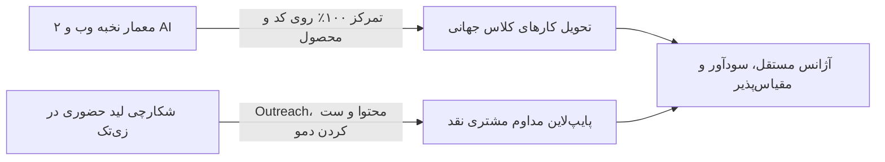
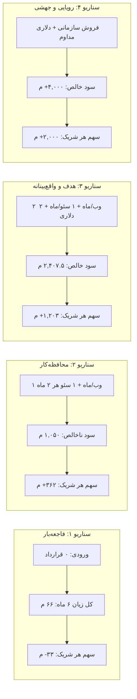

# سند جامع استراتژیک و تصمیم‌گیری تأسیس آژانس
## برنامه ۶ ماهه، ساختار هزینه‌ها، مدل مالی ۴ سناریویی و پیش‌بینی درآمد شرکا و شکارچی لید
### هم‌بنیان‌گذاران: حسن شاهمرادی و شریک هم‌بنیان‌گذار (مدل ۵۰٪ - ۵۰٪)
### دفتر کار: تهران، بلوار پژوهش، ساختمان رویش، مرکز نوآوری زی‌تک (ZTech)، واحد ۱۰۴

---

## ۱. منطق استراتژیک تصمیم (The "Why")

* **حل ریشه‌ای مشکل:** بنیان‌گذاران فنی عاشق کدنویسی و معماری سیستم هستند، اما اصطکاک ذهنی شدیدی در فروش و دایرکت زدن دارند.
* **اهرم شراکت ۵۰/۵۰:** با تقسیم هزینه‌های ثابت، با پرداخت ماهیانه ۱۶.۵ تا ۱۹ میلیون تومان برای هر شریک، دفتر شیک زی‌تک، نیروی فروش حضوری و زیرساخت‌های AI تأمین می‌شود.

---

## ۲. تعرفه‌های پایه و ساختار مالی (دقیق و مصوب)

### ۲.۱. تعرفه خدمات اصلی استودیو
* **طراحی و توسعه مهندسی وب (میانگین):** **۱۰۰,۰۰۰,۰۰۰ تومان** (بازه ۷۰ تا ۱۵۰ میلیون تومان).
* **خدمات ماهانه سئو و رشد مستمر (MRR):** **۵۰,۰۰۰,۰۰۰ تومان در ماه** (درآمد مستقیم و پایدار سیستم).
* **پروژه بین‌المللی ارزی (دلاری):** **\$1,500 دلار با نرخ مصوب ۲۷۰,۰۰۰ تومان = ۴۰۵,۰۰۰,۰۰۰ تومان**.

---

### ۲.۲. ساختار حقوق و کمیسیون پلکانی شکارچی لید (انگیزه‌بخش و عملکردمحور)

#### ۱. حقوق پایه ماهانه:
* **ماه بدون قرارداد:** **۱۵,۰۰۰,۰۰۰ تومان** (تضمین حداقلی حضور و تلاش).
* **با بستن حداقل ۱ قرارداد در ماه:** **پرش فوری به ۲۰,۰۰۰,۰۰۰ تومان** (پاداش ۵ میلیونی مستقیم روی پایه).

#### ۲. کمیسیون قراردادهای طراحی وب و اپلیکیشن (داخلی):
* **۱ قرارداد در ماه:** **۱۰٪** (۱۰ میلیون تومان)
* **۲ تا ۴ قرارداد در ماه:** **۱۵٪** (۱۵ میلیون تومان به ازای هر پروژه)
* **۵ قرارداد به بالا در ماه:** **۲۰٪** (۲۰ میلیون تومان به ازای هر پروژه)

#### ۳. کمیسیون خدمات سئو (MRR):
* **ماه اول قرارداد:** **۱۵٪** (۷.۵ میلیون تومان از تعرفه ۵۰ میلیونی).
* **ماه‌های تمدید بعدی:** **۵٪ مستمر** (۲.۵ میلیون تومان ماهانه تا زمان تمدید).

#### ۴. کمیسیون پروژه‌های ارزی (دلاری با نرخ ۲۷۰ هزار تومان):
* **۱ پروژه:** **۲۰٪** (از پروژه ۱۵۰۰ دلاری معادل ۴۰۵ م $\rightarrow$ **۸۱,۰۰۰,۰۰۰ تومان پورسانت**)
* **۲ تا ۵ پروژه:** **۲۵٪** (به ازای هر پروژه $\rightarrow$ **۱۰۱,۲۵۰,۰۰۰ تومان**)
* **۶ پروژه به بالا:** **۳۰٪** (به ازای هر پروژه $\rightarrow$ **۱۲۱,۵۰۰,۰۰۰ تومان**)

---

### ۲.۳. ساختار هزینه‌های ثابت ماهانه آژانس (تقسیم ۵۰٪ - ۵۰٪)

| سرفصل هزینه | شرح | کل ماهانه (بدون قرارداد) | کل ماهانه (با قرارداد) | سهم حسن (۵۰٪) | سهم شریک (۵۰٪) |
| :--- | :--- | :---: | :---: | :---: | :---: |
| **حقوق پایه هانتر** | حضور در زی‌تک و فعالیت منظم | ۱۵,۰۰۰,۰۰۰ | ۲۰,۰۰۰,۰۰۰ | ۷.۵ / ۱۰ م | ۷.۵ / ۱۰ م |
| **دفتر کار زی‌تک (واحد ۱۰۴)** | اجاره، شارژ، فیبر نوری، جلسات | ۱۲,۰۰۰,۰۰۰ | ۱۲,۰۰۰,۰۰۰ | ۶,۰۰۰,۰۰۰ | ۶,۰۰۰,۰۰۰ |
| **اکانت‌های AI و سرورها** | ChatGPT Plus، Claude Pro، هاست | ۴,۰۰۰,۰۰۰ | ۴,۰۰۰,۰۰۰ | ۲,۰۰۰,۰۰۰ | ۲,۰۰۰,۰۰۰ |
| **تنخواه و پذیرایی جلسات** | پذیرایی کارفرمایان، ملزومات | ۲,۰۰۰,۰۰۰ | ۲,۰۰۰,۰۰۰ | ۱,۰۰۰,۰۰۰ | ۱,۰۰۰,۰۰۰ |
| **جمع کل هزینه ثابت ماهانه** | **تعهد بقای سیستم** | **۳۳,۰۰۰,۰۰۰** | **۳۸,۰۰۰,۰۰۰** | **۱۶.۵ الی ۱۹ م** | **۱۶.۵ الی ۱۹ م** |

---

## ۳. مدل‌سازی مالی ۴ سناریویی در افق ۶ ماهه

---

### سناریو ۱: فاجعه‌بار / بدترین حالت (Catastrophic - ۰ قرارداد)
* **فرضیات:** صفر قرارداد در ۶ ماه؛ حقوق پایه هانتر روی ۱۵ میلیون تومان می‌ماند.
* **کل هزینه ثابت ماهانه:** ۳۳,۰۰۰,۰۰۰ تومان (سهم هر شریک: ۱۶.۵ میلیون تومان).
* **پروتکل خروج (Kill-Switch):** اگر تا روز ۶۰ خروجی حاصل نشد، جایگزینی هانتر انجام می‌شود.
* **حداکثر ریسک مالی واقعی هر شریک:** **۳۳,۰۰۰,۰۰۰ تومان** (معادل ۲ ماه).

---

### سناریو ۲: محافظه‌کارانه / حداقل حیات (Conservative)
* **فرضیات:**
  * **وب:** ماهانه فقط **۱ پروژه** (۱۰۰ میلیون تومان) $\rightarrow$ کمیسیون ۱۰٪.
  * **سئو:** جذب **۱ مشتری هر ۲ ماه** (ماه‌های ۲، ۴، ۶) با تعرفه ۵۰ میلیون تومان $\rightarrow$ کمیسیون ۱۵٪ ماه اول و ۵٪ ماه‌های بعد.
  * **دلاری:** ۰.

| ماه | ورودی وب | ورودی سئو | ناخالص | دریافتی هانتر (پایه+پورسانت) | هزینه ثابت | سود خالص ماهانه | سهم هر شریک (۵۰٪) |
| :---: | :---: | :---: | :---: | :---: | :---: | :---: | :---: |
| **ماه ۱** | ۱۰۰ م | ۰ | ۱۰۰ م | ۳۰ م (۲۰پایه + ۱۰پورسانت) | ۳۸ م | ۵۲,۰۰۰,۰۰۰ | **۲۶,۰۰۰,۰۰۰** |
| **ماه ۲** | ۱۰۰ م | ۵۰ م | ۱۵۰ م | ۳۷.۵ م (۲۰پایه + ۱۷.۵پورسانت) | ۳۸ م | ۹۴,۵۰۰,۰۰۰ | **۴۷,۲۵۰,۰۰۰** |
| **ماه ۳** | ۱۰۰ م | ۵۰ م | ۱۵۰ م | ۳۲.۵ م (۲۰پایه + ۱۲.۵پورسانت) | ۳۸ م | ۹۹,۵۰۰,۰۰۰ | **۴۹,۷۵۰,۰۰۰** |
| **ماه ۴** | ۱۰۰ م | ۱۰۰ م | ۲۰۰ م | ۴۰ م (۲۰پایه + ۲۰پورسانت) | ۳۸ م | ۱۴۲,۰۰۰,۰۰۰ | **۷۱,۰۰۰,۰۰۰** |
| **ماه ۵** | ۱۰۰ م | ۱۰۰ م | ۲۰۰ م | ۳۵ م (۲۰پایه + ۱۵پورسانت) | ۳۸ م | ۱۴۷,۰۰۰,۰۰۰ | **۷۳,۵۰۰,۰۰۰** |
| **ماه ۶** | ۱۰۰ م | ۱۵۰ م | ۲۵۰ م | ۴۲.۵ م (۲۰پایه + ۲۲.۵پورسانت) | ۳۸ م | ۱۸۹,۵۰۰,۰۰۰ | **۹۴,۷۵۰,۰۰۰** |
| **مجموع** | **۶۰۰ م** | **۴۵۰ م** | **۱,۰۵۰ م** | **۲۱۷,۵۰۰,۰۰۰ تومان** | **۲۲۸ م** | **۷۲۴,۵۰۰,۰۰۰** | **۳۶۲,۲۵۰,۰۰۰ تومان** |

---

### سناریو ۳: هدف و واقع‌بینانه (Target Scenario - ۲ وب، ۱ سئوی ماهانه، ۲ دلاری)
* **فرضیات:**
  * **وب:** ماهانه **۲ پروژه** (۲۰۰ میلیون تومان) $\rightarrow$ کمیسیون ۱۵٪ (۳۰ میلیون تومان).
  * **سئو:** جذب **۱ مشتری جدید در هر ماه** (اضافه شدن ۵۰ میلیون تومان در هر ماه به MRR).
  * **دلاری:** ۱ پروژه (\$1,500 با نرخ ۲۷۰ هزار تومان = **۴۰۵ میلیون تومان**) در ماه ۳ و ۱ پروژه در ماه ۵ $\rightarrow$ کمیسیون ۲۰٪ (**۸۱ میلیون تومان**).

| ماه | ورودی وب | ورودی سئو | دلاری ($1,500) | کل ناخالص | دریافتی هانتر (پایه+پورسانت) | هزینه ثابت | سود خالص ماهانه | سهم هر شریک (۵۰٪) |
| :---: | :---: | :---: | :---: | :---: | :---: | :---: | :---: | :---: |
| **ماه ۱** | ۲۰۰ م | ۵۰ م | ۰ | ۲۵۰ م | ۵۷.۵ م (۲۰+۳۷.۵) | ۳۸ م | ۱۷۴,۵۰۰,۰۰۰ | **۸۷,۲۵۰,۰۰۰** |
| **ماه ۲** | ۲۰۰ م | ۱۰۰ م | ۰ | ۳۰۰ م | ۶۰.۰ م (۲۰+۴۰.۰) | ۳۸ م | ۲۲۲,۰۰۰,۰۰۰ | **۱۱۱,۰۰۰,۰۰۰** |
| **ماه ۳** | ۲۰۰ م | ۱۵۰ م | ۴۰۵ م | ۷۵۵ م | ۱۴۳.۵ م (۲۰+۱۲۳.۵) | ۳۸ م | ۵۹۳,۵۰۰,۰۰۰ | **۲۹۶,۷۵۰,۰۰۰** |
| **ماه ۴** | ۲۰۰ م | ۲۰۰ م | ۰ | ۴۰۰ م | ۶۵.۰ م (۲۰+۴۵.۰) | ۳۸ م | ۳۱۷,۰۰۰,۰۰۰ | **۱۵۸,۵۰۰,۰۰۰** |
| **ماه ۵** | ۲۰۰ م | ۲۵۰ م | ۴۰۵ م | ۸۵۵ م | ۱۴۸.۵ م (۲۰+۱۲۸.۵) | ۳۸ م | ۶۸۸,۵۰۰,۰۰۰ | **۳۴۴,۲۵۰,۰۰۰** |
| **ماه ۶** | ۲۰۰ م | ۳۰۰ م | ۰ | ۵۰۰ م | ۷۰.۰ م (۲۰+۵۰.۰) | ۳۸ م | ۴۱۲,۰۰۰,۰۰۰ | **۲۰۶,۰۰۰,۰۰۰** |
| **مجموع** | **۱,۲۰۰ م**| **۱,۰۵۰ م**| **۸۱۰ م** | **۳,۰۶۰ م** | **۵۴۴,۵۰۰,۰۰۰ تومان** | **۲۲۸ م** | **۲,۴۰۷,۵۰۰,۰۰۰**| **۱,۲۰۳,۷۵۰,۰۰۰ تومان** |

> [!TIP]
> **دست‌آورد سناریوی هدف:**  
> ۱. سود خالص هر شریک در ۶ ماه از **۱.۲ میلیارد تومان** عبور می‌کند.  
> ۲. دو پروژه دلاری با نرخ دلار ۲۷۰ هزار تومانی، به تنهایی ۸۱۰ میلیون تومان درآمد ناخالص و ۱۶۲ میلیون تومان پورسانت نقدی برای هانتر خلق می‌کنند.  
> ۳. کف درآمد ماهانه مستمر (MRR) سئو در پایان ماه ششم به **۳۰۰ میلیون تومان در ماه** می‌رسد که ۷.۹ برابر کل هزینه‌های آژانس است.

---

### سناریو ۴: رویایی و جهشی (Dream Scenario)
* ۳ الی ۵ قرارداد وب در ماه (کمیسیون ۲۰٪) + ۲ مشتری سئوی سازمانی در ماه + ورودی مداوم دلاری (۲ پروژه در ماه معادل ۸۱۰ میلیون تومان ورودی ارزی).
* **گردش مالی ۶ ماهه:** بالای ۵ میلیارد تومان.
* **دریافتی ماهانه هانتر:** بالای ۱۵۰ الی ۲۰۰ میلیون تومان.
* **سود خالص ماهانه هر هم‌بنیان‌گذار:** ۳۰۰ الی ۵۰۰ میلیون تومان در ماه.

---

## ۴. جدول مقایسه‌ای پیش‌بینی درآمد خود لید هانتر (Lead Hunter Earnings)

این جدول مستقیماً انگیزه درآمدی هانتر را در هر سناریو و در طول ماه‌ها شفاف می‌کند:

| سناریوی عملکردی | میانگین دریافتی ماهانه هانتر | سقف دریافتی در یک ماه | کل درآمد ۶ ماهه هانتر | انگیزه و وضعیت روانی هانتر |
| :--- | :---: | :---: | :---: | :--- |
| **۱. فاجعه‌بار (بدون قرارداد)** | ۱۵,۰۰۰,۰۰۰ تومان | ۱۵,۰۰۰,۰۰۰ تومان | ۹۰,۰۰۰,۰۰۰ تومان | حقوق پایه صرف، قطع همکاری در ماه ۲ |
| **۲. محافظه‌کارانه (۱ وب/ماه + سئو آرام)** | ۳۶,۲۵۰,۰۰۰ تومان | ۴۲,۵۰۰,۰۰۰ تومان | ۲۱۷,۵۰۰,۰۰۰ تومان | درآمد ۲ برابر اداره کاری، ثبات نسبی |
| **۳. هدف (۲ وب/ماه + ۱ سئو + ۲ دلاری)** | **۹۰,۷۵۰,۰۰۰ تومان** | **۱۴۸,۵۰۰,۰۰۰ تومان** | **۵۴۴,۵۰۰,۰۰۰ تومان** | **انفجار مالی، انگیزه و تعهد حداکثری** |
| **۴. رویایی (فروش سازمانی و دلاری مداوم)** | **۱۵۰ تا ۲۰۰ م** | **۲۰۰,۰۰۰,۰۰۰+ تومان** | **۱,۰۰۰,۰۰۰,۰۰۰+ تومان** | تبدیل شدن به شریک ارشد فروش و برندینگ |

---

## ۵. تحلیل نقطه سر‌به‌سر (Break-Even) و تاب‌آوری مالی

با توجه به هزینه ثابت ۳۸ میلیون تومانی آژانس (در حالت بستن قرارداد):
1. **فروش تنها ۱ پروژه وب (۱۰۰ م):** ۱۰ میلیون پورسانت کسر می‌شود؛ ۹۰ میلیون باقی می‌ماند. پس از کسر ۳۸ میلیون هزینه ثابت، **۵۲ میلیون تومان سود خالص در همان ماه اول** به دست می‌آید.
2. **یا جذب تنها ۱ قرارداد سئو (۵۰ م):** در همان ماه اول ۷.۵ م پورسانت کسر می‌شود؛ ۴۲.۵ م باقی می‌ماند که کل ۳۸ م هزینه را پوشش می‌دهد.
3. **نتیجه قطعی:** **تنها با ۱ فروش در ماه، ریسک کسب‌وکار صفر است.**
4. **سرمایه اولیه مورد نیاز (Buffer):** هر شریک ۳۳ میلیون تومان برای پوشش ۲ ماه اول در حساب تنخواه قرار می‌دهد.

---

## ۶. نقشه راه عملیاتی ۲۴ تا ۴۸ ساعت آینده

1. **تایید نهایی دو شریک:** توافق بر سهم ۱۶.۵ تا ۱۹ میلیونی ماهانه و تزریق ۳۳ میلیون بافر اولیه.
2. **انتشار آگهی استخدام با شرایط جدید:** انتشار بنرها و هدایت به لندینگ استخدام `hasanshah.ir/careers/`.
3. **فیلتر ویدیوهای ۳۰ ثانیه‌ای تلگرام (@shahbusinessman):** انتخاب ۳ کاندیدای برتر و مصاحبه در مرکز نوآوری زی‌تک.

---
*سند رسمی تصمیم‌گیری هم‌بنیان‌گذاران — نسخه ۲.۰ اصلاح‌شده بر اساس تارگت‌های نهایی.*
