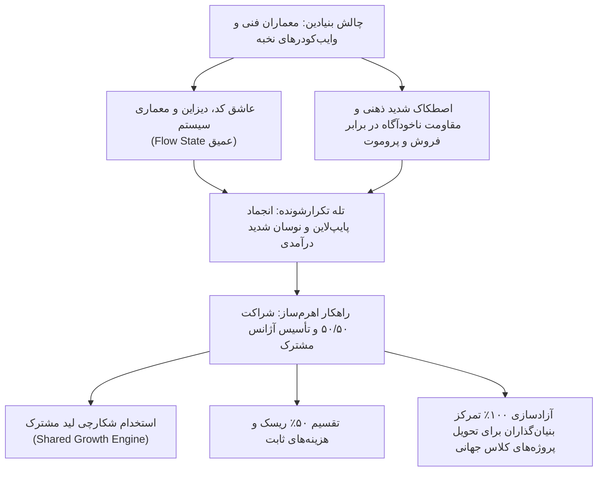
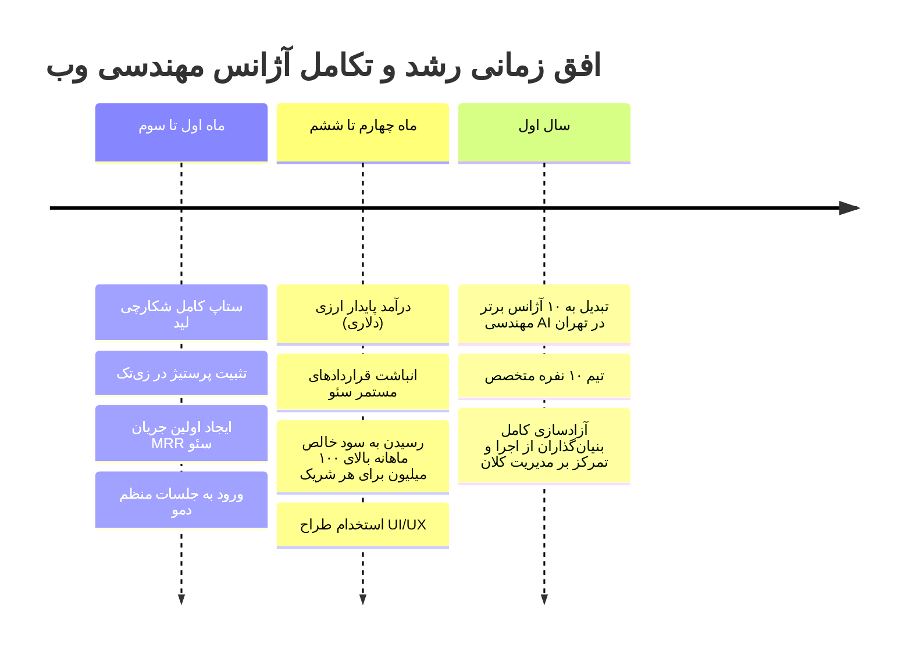
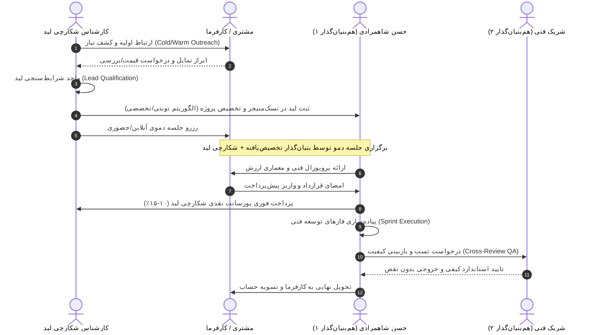
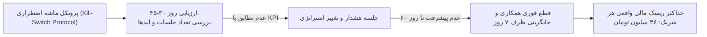
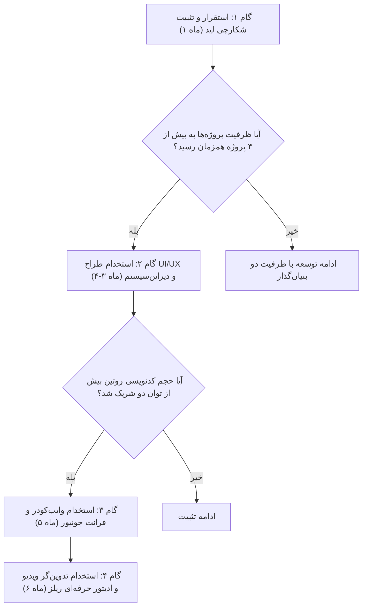

# سند جامع استراتژیک، عملیاتی و تصمیم‌گیری تأسیس آژانس
## برنامه ۶ ماهه شراکت، مدل‌سازی مالی ۴ سناریویی، ساختار هزینه‌ها و نقشه راه توسعه
### تهیه‌شده برای هم‌بنیان‌گذاران: حسن شاهمرادی و شریک هم‌بنیان‌گذار (مدل سرمایه‌گذاری ۵۰٪ - ۵۰٪)
### استقرار مرکزی: تهران، بلوار پژوهش، ساختمان رویش، مرکز نوآوری زی‌تک (ZTech)، واحد ۱۰۴

---

## ۱. فلسفه وجودی و ریشه‌یابی تصمیم استراتژیک (The Core "Why")



### ۱.۱. کالبدشکافی چالش روان‌شناختی بنیان‌گذاران فنی
واقعیت غیرقابل انکاری که در طول ماه‌ها تجربه اثبات شده این است:  
هر دو هم‌بنیان‌گذار این مجموعه در اوج تخصص مهندسی وب مدرن، معماری نرم‌افزار، بهینه‌سازی سئو و وایب‌کدینگ با مدل‌های زبانی بزرگ (LLMs) قرار دارند. وقتی پای کدنویسی، طراحی سیستم و دیزاین رابط کاربری می‌نشینند، ساعت‌ها بدون خستگی در حالت «غرقگی محض» (Flow State) محصولاتی در کلاس جهانی خلق می‌کنند.

اما مشکل کجاست؟  
**پاشنه آشیل مشترک هر دو، مقاومت ذهنی ناخودآگاه و اصطکاک فرساینده در مواجهه با امور فروش، بازاریابی بیرونی، دایرکت زدن، زنگ زدن به کارفرمایان و چانه‌زنی‌های مالی است.**  
تلاش برای وادار کردن یک مهندس معمار به این که خودش همزمان لید تولید کند، خودش پیام بدهد، خودش فیلم بگیرد و خودش بفروشد، به دو نتیجه فاجعه‌بار منجر شده است:
1. انرژی روانی سازنده تخلیه می‌شود و کیفیت و سرعت توسعه محصول به شدت افت می‌کند.
2. به دلیل تعویق انداختن مداوم فروش، جریان ورود مشتریان جدید متوقف می‌شود و درآمدها دچار نوسان ناپایدار می‌گردد.

### ۱.۲. چرا شراکت ۵۰/۵۰ و تأسیس «آژانس مشترک» بالاترین اهرم مالی است؟
شراکت و تقسیم ۵۰/۵۰ هزینه‌ها، قفل این بحران ساختاری را می‌شکند:
* **نصف شدن ریسک و هزینه‌های ثابت:** هزینه استخدام شکارچی لید حضوری، اجاره دفتر نوآوری زی‌تک، ابزارها و زیرساخت‌ها بین دو نفر تقسیم می‌شود؛ در نتیجه هزینه سنگینی بر دوش هیچ‌یک از شرکا نخواهد بود.
* **برون‌سپاری هوشمندانه ضعف‌ها به یک متخصص:** به جای جنگیدن با ضعف خود، فردی را استخدام می‌کنیم (شکارچی لید) که هوش کلامی بالایی دارد، عاشق ارتباطات و پیگیری است و دقیقاً همان کارهایی را با اشتیاق انجام می‌دهد که انرژی برنامه‌نویس را می‌سوزاند.
* **جریان پایدار لید و انباشت درآمد مستمر (MRR):** موتور بازاریابی متوقف نمی‌شود، حتی زمانی که هر دو شریک در حال پیاده‌سازی فازهای سنگین کدنویسی هستند.

---

## ۲. چشم‌انداز، رسالت و اهداف کلان (Vision & Milestones)



### ۲.۱. رسالت آژانس (Agency Mission)
ارائه بالاترین استاندارد مهندسی وب، رابط‌های کاربری لوکس، معماری مدرن نرم‌افزار با Next.js و بهینه‌سازی موتورهای جستجو (SEO) با استفاده از اهرم هوش مصنوعی؛ تبدیل کردن وب‌سایت‌های شرکتی، خدماتی و فروشگاهی از یک ویترین خسته‌کننده به ماشین‌های سودآور تبدیل لید و فروش.

### ۲.۲. اهداف ۶ ماهه (Milestone 6M)
1. **تثبیت جریان نقدینگی ماهانه مستمر (MRR) از سئو:** رسیدن به حداقل ۶ الی ۸ قرارداد سئوی فعال ماهانه (تأمین درآمد ماهانه حداقل ۱۲۰ تا ۱۶۰ میلیون تومان فقط از سئو بدون نیاز به فروش پروژه جدید).
2. **جذب منظم پروژه‌های توسعه وب:** بستن ۲ الی ۳ قرارداد طراحی و سیستم‌سازی در هر ماه (میانگین ۶۰ میلیون تومان به ازای هر پروژه).
3. **گشایش کانال درآمد ارزی (دلاری):** جذب حداقل ۳ پروژه دلاری بین‌المللی با ارزش میانگین \$1,500 در پلتفرم‌های آپ‌ورک، فریلنسر یا ارتباط مستقیم با کارفرمایان خارج از کشور.
4. **صفر کردن دغدغه بازاریابی:** رسیدن به نقطه‌ای که تقویم هفتگی بنیان‌گذاران حاوی ۳ الی ۵ جلسه دموی گرم با مشتریان دست‌به‌نقد باشد.

### ۲.۳. اهداف ۱ ساله (Milestone 1Y)
1. تثبیت برند آژانس به عنوان یکی از مرجع‌های اصلی توسعه وب با هوش مصنوعی و وایب‌کدینگ در ایران.
2. راه‌اندازی واحد بازاریابی دلاری اختصاصی و گسترش خدمات به بازار کشورهای حاشیه خلیج فارس (امارات، عمان، قطر).
3. مقیاس‌گذاری ساختار سازمانی به یک تیم چابک ۷ الی ۱۰ نفره (شامل وایب‌کودرها، طراحان رابط کاربری، تولیدکنندگان محتوا و کارشناسان سئو).

---

## ۳. فرآیندهای عملیاتی و نحوه هماهنگی بین دو هم‌بنیان‌گذار (Co-Founder Operations)

برای جلوگیری از هرگونه تعارض، افت کیفیت یا تداخل در روند کار، ماتریس هماهنگی و تقسیم کار زیر تدوین شده است:



### ۳.۱. مدل تخصیص پروژه‌ها بین دو شریک (Project Allocation Logic)
تمام لیدهایی که توسط شکارچی لید جذب می‌شوند وارد پایپ‌لاین مرکزی استودیو می‌گردند. تخصیص پروژه‌ها بر اساس ۳ فیلتر زیر انجام می‌شود:
1. **فیلتر تخصص موضوعی:** پروژه‌های تعاملی، انیمیشن‌های سنگین، لندینگ‌های خلاقانه و برندینگ لوکس به حسن؛ پروژه‌های پلتفرمی سنگین، دیتابیس‌محور، فروشگاهی پیچیده یا زیرساختی به شریک (یا بالعکس متناسب با توافق).
2. **فیلتر ظرفیت زمانی (Bandwidth Availability):** اگر یکی از شرکا همزمان درگیر ۲ پروژه در حال تحویل باشد، لید جدید به شریک دیگر با ظرفیت آزاد منتقل می‌شود تا ددلاین‌ها نسوزد.
3. **قاعده چرخشی عادلانه (Round-Robin):** در شرایط عادی، پروژه‌ها به صورت یک‌درمیان بین دو شریک تقسیم می‌شود تا جریان درآمدی هر دو متوازن بماند.

### ۳.۲. فرآیند برگزاری دمو، پروپوزال و بستن قرارداد (Demo & Closing Process)
* **نقش شکارچی لید:** آماده‌سازی کارفرما، ارسال کاتالوگ و نمونه‌کارها، دریافت بریف مقدماتی و هماهنگی لینک گوگل میت یا سالن جلسات در مرکز نوآوری زی‌تک.
* **نقش بنیان‌گذار در جلسه:** بنیان‌گذار به عنوان «سرمهندس معمار» در جلسه حاضر می‌شود. تمرکز بنیان‌گذار صرفاً بر نمایش عمق فنی، تحلیل دغدغه‌های کسب‌وکار مشتری، ارائه راه‌حل‌های نوآورانه با هوش مصنوعی و خلق اعتبار است.
* **بستن قرارداد:** پیش‌نویس استاندارد قرارداد استودیو آماده است؛ رقم، فازهای پرداخت و تعهدات مشخص می‌شود و قرارداد با پیش‌پرداخت حداقل ۴۰ الی ۵۰ درصد منعقد می‌گردد.

### ۳.۳. نظارت متقابل بر کیفیت (Cross-Review QA)
هیچ کدی، هیچ لندینگی و هیچ پروژه‌ای بدون تایید شریک دیگر به کارفرما دلیور نمی‌شود. این فرآیند دو مزیت حیاتی دارد:
* کشف باگ‌ها، ایرادات ریسپانسیو و خطاهای تایپوگرافی قبل از اینکه مشتری متوجه شود.
* تضمین اینکه نام و برند آژانس در تمام پروژه‌ها یک استاندارد یکپارچه و اعلا را منعکس کند.

---

## ۴. ساختار هزینه‌های مشترک آژانس (پیش‌بینی ۶ ماهه)

هزینه‌های آژانس به دو دسته شفاف **هزینه‌های ثابت ماهانه (Fixed Operational Costs)** و **هزینه‌های متغیر پروژه‌ای (Variable Costs)** تقسیم می‌شود.

### ۴.۱. جدول هزینه‌های ثابت ماهانه (Shared Fixed Overhead)

| ردیف | سرفصل هزینه | شرح و جزییات | کل مبلغ ماهانه (تومان) | سهم حسن (۵۰٪) | سهم شریک (۵۰٪) |
| :---: | :--- | :--- | :---: | :---: | :---: |
| **۱** | **حقوق پایه شکارچی لید** | حقوق تضمینی ماهانه جهت حضور در دفتر زی‌تک، تردد و تعهد زمانی کامل | ۱۸,۰۰۰,۰۰۰ | ۹,۰۰۰,۰۰۰ | ۹,۰۰۰,۰۰۰ |
| **۲** | **دفتر کار مرکز نوآوری زی‌تک** | واحد ۱۰۴، شارژ، اینترنت فیبر پرسرعت، خدمات پذیرایی، امکانات جلسات | ۱۲,۰۰۰,۰۰۰ | ۶,۰۰۰,۰۰۰ | ۶,۰۰۰,۰۰۰ |
| **۳** | **اشتراک‌های نرم‌افزار و AI** | اکانت‌های ChatGPT Plus، Claude Pro، ابزارهای سئو، سرورها و ابزارهای مانیتورینگ | ۴,۰۰۰,۰۰۰ | ۲,۰۰۰,۰۰۰ | ۲,۰۰۰,۰۰۰ |
| **۴** | **تنخواه‌گردان و ملزومات روزمره** | ملزومات اداری، پذیرایی جلسات حضوری با کارفرمایان و هزینه‌های پیش‌بینی‌نشده | ۲,۰۰۰,۰۰۰ | ۱,۰۰۰,۰۰۰ | ۱,۰۰۰,۰۰۰ |
| **—** | **مجموع هزینه ثابت ماهانه** | **کل نقدینگی مورد نیاز برای بقای کامل عملیات در هر ماه** | **۳۶,۰۰۰,۰۰۰** | **۱۸,۰۰۰,۰۰۰** | **۱۸,۰۰۰,۰۰۰** |

> [!IMPORTANT]
> **تعهد ثابت ماهانه هر شریک:** تنها **۱۸ میلیون تومان در ماه**!  
> این یعنی با روزی ۶۰۰ هزار تومان برای هر نفر، یک دفتر شیک و معتبر در مرکز نوآوری، یک نیروی فروش و بازاریابی حضوری مجهز به آیفون و تمام زیرساخت‌های هوش مصنوعی فعال است.

### ۴.۲. جدول هزینه‌های متغیر و پورسانت‌ها (Variable Costs)
این هزینه‌ها فقط و فقط در صورت «ورود پول و بستن قرارداد» پرداخت می‌شوند و بار ثابت ندارند:
* **پورسانت نقدی پروژه‌های وب:** ۱۰ الی ۱۵ درصد از رقم قرارداد (کسر از درآمد همان پروژه).
* **پورسانت قراردادهای سئو (MRR):** ۱۰ الی ۱۵ درصد از صورت‌حساب ماهانه سئو (کسر از دریافتی همان ماه).
* **پورسانت پروژه‌های دلاری:** ۱۵ الی ۲۰ درصد از عایدی ناخالص دلاری.
* **هاست، دامین و سرور پروژه:** مستقیماً توسط کارفرما پرداخت می‌شود یا روی فاکتور نهایی لحاظ می‌گردد (هزینه صفر برای آژانس).

---

## ۵. مدل‌سازی مالی ۴ سطحی در افق ۶ ماهه (Financial Modeling & Scenario Analysis)

### مبنای قیمت‌گذاری و تعرفه‌های واقعی خدمات استودیو
* **پروژه طراحی و توسعه مهندسی وب (متوسط):** **۶۰,۰۰۰,۰۰۰ تومان** (بازه واقعی: ۴۰ الی ۱۰۰+ میلیون تومان).
* **قرارداد خدمات ماهانه سئو و رشد مستمر (MRR):** **۲۰,۰۰۰,۰۰۰ تومان در ماه** (بازه واقعی: ۱۵ الی ۳۰ میلیون تومان).
* **پروژه بین‌المللی ارزی (دلاری):** **\$1,500 دلار** (با احتساب برابری هر دلار ۱۰۰,۰۰۰ تومان = ۱۵۰,۰۰۰,۰۰۰ تومان).

---

### ۵.۱. سناریو ۱: فاجعه‌بار / بدترین حالت فرضی (Catastrophic / Absolute Worst Case)
* **فرضیات:** شکارچی لید حتی یک قرارداد هم نبندد! صفر پروژه وب، صفر قرارداد سئو و صفر دلار ورودی در کل ۶ ماه.
* **نرخ سوخت ماهانه (Monthly Burn Rate):** ۳۶,۰۰۰,۰۰۰ تومان.
* **کل هزینه تلف‌شده در ۶ ماه:** ۲۱۶,۰۰۰,۰۰۰ تومان.
* **سهم ضرر هر شریک در ۶ ماه:** ۱۰۸,۰۰۰,۰۰۰ تومان (ماهانه ۱۸ میلیون تومان).



> [!TIP]
> **تحلیل مدیریت ریسک و پروتکل خروج اضطراری (Kill-Switch):**  
> هیچ کسب‌وکار عاقلی ۶ ماه به نظاره صفر ماندن خروجی نمی‌نشیند. بر اساس پروتکل ارزیابی ۳۰-۶۰-۹۰، اگر شکارچی لید تا پایان ماه دوم نتواند حداقل ۲ قرارداد ببندد، بلافاصله فرآیند جایگزینی فعال می‌شود. بنابراین حداکثر سرمایه در معرض ریسک هر شریک، هزینه ۲ ماه اول یعنی **۳۶ میلیون تومان** است؛ رقمی بسیار منطقی و قابل چشم‌پوشی در ازای تست یک موتور رشد بیزینسی.

---

### ۵.۲. سناریو ۲: محافظه‌کارانه / حداقل حیات (Conservative / Minimum Viable)
* **فرضیات:**  
  - جذب تنها **۱ پروژه طراحی وب در هر ماه** (۶۰ میلیون تومان).
  - جذب تنها **۱ مشتری سئو در هر دو ماه** (ماه دوم: ۱ مشتری، ماه چهارم: ۲ مشتری، ماه ششم: ۳ مشتری فعال).
  - صفر پروژه دلاری.
* **سهم پورسانت شکارچی لید:** ۱۰٪ از پروژه‌ها + ۱۰٪ از سئو.

#### جدول جریان نقدی ماه به ماه سناریوی محافظه‌کارانه (ارقام به تومان):

| ماه | ورودی وب | ورودی سئو (MRR) | کل درآمد ناخالص | پورسانت هانتر (۱۰٪) | هزینه ثابت آژانس | سود خالص ماهانه | سهم سود هر شریک (۵۰٪) |
| :---: | :---: | :---: | :---: | :---: | :---: | :---: | :---: |
| **ماه اول** | ۶۰,۰۰۰,۰۰۰ | ۰ | ۶۰,۰۰۰,۰۰۰ | ۶,۰۰۰,۰۰۰ | ۳۶,۰۰۰,۰۰۰ | ۱۸,۰۰۰,۰۰۰ | **۹,۰۰۰,۰۰۰** |
| **ماه دوم** | ۶۰,۰۰۰,۰۰۰ | ۲۰,۰۰۰,۰۰۰ | ۸۰,۰۰۰,۰۰۰ | ۸,۰۰۰,۰۰۰ | ۳۶,۰۰۰,۰۰۰ | ۳۶,۰۰۰,۰۰۰ | **۱۸,۰۰۰,۰۰۰** |
| **ماه سوم** | ۶۰,۰۰۰,۰۰۰ | ۲۰,۰۰۰,۰۰۰ | ۸۰,۰۰۰,۰۰۰ | ۸,۰۰۰,۰۰۰ | ۳۶,۰۰۰,۰۰۰ | ۳۶,۰۰۰,۰۰۰ | **۱۸,۰۰۰,۰۰۰** |
| **ماه چهارم**| ۶۰,۰۰۰,۰۰۰ | ۴۰,۰۰۰,۰۰۰ | ۱۰۰,۰۰۰,۰۰۰ | ۱۰,۰۰۰,۰۰۰ | ۳۶,۰۰۰,۰۰۰ | ۵۴,۰۰۰,۰۰۰ | **۲۷,۰۰۰,۰۰۰** |
| **ماه پنجم** | ۶۰,۰۰۰,۰۰۰ | ۴۰,۰۰۰,۰۰۰ | ۱۰۰,۰۰۰,۰۰۰ | ۱۰,۰۰۰,۰۰۰ | ۳۶,۰۰۰,۰۰۰ | ۵۴,۰۰۰,۰۰۰ | **۲۷,۰۰۰,۰۰۰** |
| **ماه ششم** | ۶۰,۰۰۰,۰۰۰ | ۶۰,۰۰۰,۰۰۰ | ۱۲۰,۰۰۰,۰۰۰ | ۱۲,۰۰۰,۰۰۰ | ۳۶,۰۰۰,۰۰۰ | ۷۲,۰۰۰,۰۰۰ | **۳۶,۰۰۰,۰۰۰** |
| **مجموع** | **۳۶۰,۰۰۰,۰۰۰** | **۱۸۰,۰۰۰,۰۰۰** | **۵۴۰,۰۰۰,۰۰۰** | **۵۴,۰۰۰,۰۰۰** | **۲۱۶,۰۰۰,۰۰۰**| **۲۷۰,۰۰۰,۰۰۰**| **۱۳۵,۰۰۰,۰۰۰ تومان** |

> [!NOTE]
> حتی در این سناریوی به شدت حداقلی و کند، از همان ماه اول تمام هزینه‌ها پوشش داده می‌شود و در طول ۶ ماه، هر شریک علاوه بر پوشش ۱۰۰٪ هزینه‌های دفتر و بازاریاب، **۱۳۵ میلیون تومان سود خالص** برداشت می‌کند.

---

### ۵.۳. سناریو ۳: واقع‌بینانه و هدف استراتژیک (Target / Realistic Scenario)
* **فرضیات:**  
  - **پروژه وب:** جذب **۲ پروژه طراحی وب در ماه** (هر پروژه ۶۰ میلیون = ۱۲۰ میلیون در ماه).
  - **موتور مستمر سئو (MRR):** جذب **۱ مشتری جدید سئو در هر ماه** (اثر انباشت تصاعدی: ماه ۱ = ۱ مشتری، ماه ۲ = ۲ مشتری، ... ماه ۶ = ۶ مشتری فعال).
  - **پروژه دلاری:** ثبت **۱ پروژه دلاری (\$1,500 = ۱۵۰ میلیون تومان)** در ماه سوم و **۱ پروژه دلاری** در ماه پنجم.
  - **پورسانت شکارچی لید:** ۱۲٪ از پروژه‌ها و سئو، و ۱۵٪ از درآمد دلاری.

#### جدول جریان نقدی ماه به ماه سناریوی هدف (ارقام به تومان):

| ماه | پروژه وب | سئو مستمر (MRR) | پروژه دلاری | کل درآمد ناخالص | پورسانت هانتر | هزینه ثابت | سود خالص ماهانه | سهم هر شریک (۵۰٪) |
| :---: | :---: | :---: | :---: | :---: | :---: | :---: | :---: | :---: |
| **ماه ۱** | ۱۲۰,۰۰۰,۰۰۰ | ۲۰,۰۰۰,۰۰۰ | ۰ | ۱۴۰,۰۰۰,۰۰۰ | ۱۶,۸۰۰,۰۰۰ | ۳۶,۰۰۰,۰۰۰ | ۸۷,۲۰۰,۰۰۰ | **۴۳,۶۰۰,۰۰۰** |
| **ماه ۲** | ۱۲۰,۰۰۰,۰۰۰ | ۴۰,۰۰۰,۰۰۰ | ۰ | ۱۶۰,۰۰۰,۰۰۰ | ۱۹,۲۰۰,۰۰۰ | ۳۶,۰۰۰,۰۰۰ | ۱۰۴,۸۰۰,۰۰۰ | **۵۲,۴۰۰,۰۰۰** |
| **ماه ۳** | ۱۲۰,۰۰۰,۰۰۰ | ۶۰,۰۰۰,۰۰۰ | ۱۵۰,۰۰۰,۰۰۰ | ۳۳۰,۰۰۰,۰۰۰ | ۴۴,۱۰۰,۰۰۰ | ۳۶,۰۰۰,۰۰۰ | ۲۴۹,۹۰۰,۰۰۰ | **۱۲۴,۹۵۰,۰۰۰** |
| **ماه ۴** | ۱۲۰,۰۰۰,۰۰۰ | ۸۰,۰۰۰,۰۰۰ | ۰ | ۲۰۰,۰۰۰,۰۰۰ | ۲۴,۰۰۰,۰۰۰ | ۳۶,۰۰۰,۰۰۰ | ۱۴۰,۰۰۰,۰۰۰ | **۷۰,۰۰۰,۰۰۰** |
| **ماه ۵** | ۱۲۰,۰۰۰,۰۰۰ | ۱۰۰,۰۰۰,۰۰۰| ۱۵۰,۰۰۰,۰۰۰ | ۳۷۰,۰۰۰,۰۰۰ | ۴۸,۹۰۰,۰۰۰ | ۳۶,۰۰۰,۰۰۰ | ۲۸۵,۱۰۰,۰۰۰ | **۱۴۲,۵۵۰,۰۰۰** |
| **ماه ۶** | ۱۲۰,۰۰۰,۰۰۰ | ۱۲۰,۰۰۰,۰۰۰| ۰ | ۲۴۰,۰۰۰,۰۰۰ | ۲۸,۸۰۰,۰۰۰ | ۳۶,۰۰۰,۰۰۰ | ۱۷۵,۲۰۰,۰۰۰ | **۸۷,۶۰۰,۰۰۰** |
| **مجموع** | **۷۲۰,۰۰۰,۰۰۰**| **۴۲۰,۰۰۰,۰۰۰**| **۳۰۰,۰۰۰,۰۰۰**| **۱,۴۴۰,۰۰۰,۰۰۰**| **۱۸۱,۸۰۰,۰۰۰**| **۲۱۶,۰۰۰,۰۰۰**| **۱,۰۴۲,۲۰۰,۰۰۰**| **۵۲۱,۱۰۰,۰۰۰ تومان** |

```mermaid
xychart-beta
    title درآمد ناخالص در برابر سود خالص هر شریک در سناریوی هدف (میلیون تومان)
    x-axis ["ماه ۱", "ماه ۲", "ماه ۳ (دلاری)", "ماه ۴", "ماه ۵ (دلاری)", "ماه ۶"]
    y-axis "میلیون تومان" 0 --> 400
    bar [140, 160, 330, 200, 370, 240]
    line [43.6, 52.4, 124.95, 70, 142.55, 87.6]
```

> [!TIP]
> **دست‌آورد سناریوی واقع‌بینانه:**  
> ۱. گردش مالی ناخالص آژانس به مرز **۱.۴۴ میلیارد تومان** می‌رسد.  
> ۲. هر هم‌بنیان‌گذار در طول ۶ ماه بیش از **نصف میلیارد تومان (۵۲۱ میلیون تومان)** سود خالص دریافت می‌کند.  
> ۳. در انتهای ماه ششم، آژانس دارای **۱۲۰ میلیون تومان MRR ماهانه ثابت از سئو** است که به تنهایی ۳.۳ برابر کل هزینه‌های ثابت دفتر و پرسنل را پوشش می‌دهد!

---

### ۵.۴. سناریو ۴: رویایی و جهشی (Dream / Hyper-Growth Scenario)
* **فرضیات:**  
  - ۳ الی ۴ پروژه بزرگ شرکتی و فروشگاهی در ماه (میانگین ۲۴۰ میلیون تومان در ماه).
  - جذب ۲ مشتری سئوی سازمانی در هر ماه (رسیدن به ۲۴۰ میلیون تومان MRR در انتهای ماه ۶).
  - جذب حداقل ۴ پروژه دلاری سنگین با ارزش بالای \$2,500 دلار.
* **شاخص‌های کلیدی عملکرد:**
  - گردش مالی ۶ ماهه بالای **۳ میلیارد تومان**.
  - سود خالص ماهانه هر هم‌بنیان‌گذار: **۱۵۰ الی ۲۵۰ میلیون تومان در ماه**.
  - تبدیل استودیو به یک مرجع معتبر با لایه پرسنلی توسعه‌یافته.

---

### ۵.۵. فرمول و تحلیل نقطه سر‌به‌سر (Break-Even Analysis)

نقطه سر‌به‌سر، نقطه‌ای است که کل درآمدهای ماهانه پس از کسر پورسانت هانتر، دقیقاً برابر با هزینه‌های ثابت دفتر و پرسنل ($FC = ۳۶,۰۰۰,۰۰۰$) گردد:

$$Revenue_{net} = Revenue_{gross} \times (1 - Commission) \ge FC$$

با فرض پورسانت متوسط ۱۲٪ ($0.12$):

$$Revenue_{gross} \times 0.88 \ge 36,000,000 \implies Revenue_{gross} \ge \frac{36,000,000}{0.88} \approx 40,900,000 \text{ Toman}$$

#### نتیجه اعجاب‌انگیز نقطه سر‌به‌سر:
برای اینکه آژانس در یک ماه به نقطه سر‌به‌سر ۱۰۰٪ برسد و هیچ‌کدام از شرکا حتی ۱ ریال از جیب پرداخت نکنند، **تنها یکی از شروط زیر در ماه کافی است:**
1. **فقط بستن ۱ پروژه وب متوسط (۶۰ میلیون)** $\rightarrow$ کل هزینه‌ها صفر می‌شود و حدود ۱۶ میلیون تومان سود خالص باقی می‌ماند.
2. **یا فقط داشتن ۲ مشتری مستمر سئو (۴۰ میلیون)** $\rightarrow$ کل هزینه‌ها پوشش داده می‌شود.
3. **یا بستن تنها ۱ پروژه دلاری کوچک (\$500 دلار)** $\rightarrow$ کل هزینه‌های ماهانه پوشش داده می‌شود.

این یعنی **حاشیه ایمنی (Margin of Safety)** این مدل شراکت فوق‌العاده بالاست و احتمال زیان‌دهی در دنیای واقعی نزدیک به صفر است.

---

### ۵.۶. تحلیل تاب‌آوری مالی و سرمایه در گردش اولیه شرکا (Runway & Buffer)

برای اینکه دو شریک با آرامش کامل و بدون دغدغه ذهنی فرآیند را آغاز کنند:
* **تعهد سرمایه در گردش اولیه (Initial Capital Injection):**
  - هر شریک در بدترین حالت، معادل ۲ ماه هزینه ثابت سهم خود را به عنوان بافر در حساب مشترک تنخواه شارژ می‌کند:
  $$\text{Partner Initial Buffer} = 2 \times 18,000,000 = 36,000,000 \text{ Toman}$$
* این مبلغ به آژانس اجازه می‌دهد ۶۰ روز بدون کوچک‌ترین استرس مالی، فرآیند جذب لید، مصاحبه‌ها، ستاپ پلتفرم‌ها و برگزاری جلسات را پیش ببرد.

---

## ۶. نقشه راه توسعه منابع انسانی و استخدام‌های ۶ ماه آینده (Talent Scaling Roadmap)

اضافه شدن هر نیروی جدید نباید بر اساس توهمات رشد، بلکه باید بر اساس **«نقاط ماشه مالی و ظرفیت عملیاتی (Trigger Thresholds)»** انجام شود:



### ماتریس شرایط و زمان‌بندی استخدام نقش‌های بعدی

| عنوان شغلی | زمان تخمینی | نقطه ماشه مالی و ظرفیت (Trigger Point) | اثر بر بیزینس و بنیان‌گذاران |
| :--- | :---: | :--- | :--- |
| **۱. شکارچی لید و رشد برند** | **روز ۱ (فوری)** | **همین لحظه (پایه شروع آژانس)** | فعال شدن خط لیدسازی، صفر شدن اصطکاک بازاریابی بنیان‌گذاران |
| **۲. طراح رابط کاربری (UI/UX Designer)** | **ماه ۳ الی ۴** | رسیدن به درآمد ناخالص بالای ۱۸۰ میلیون در ماه و همزمانی بیش از ۳ پروژه دیزاین | انتقال مراحل وایرفریم، فیگما و طراحی کامپوننت‌ها به طراح؛ آزادسازی وقت شرکا برای کدنویسی و معماری |
| **۳. مهندس فرانت‌اند جونیور / وایب‌کودر** | **ماه ۴ الی ۵** | رسیدن به بیش از ۵ پروژه فعال همزمان و انباشت تسک‌های کارهای تکراری فرانت | تسریع ۲ برابری در دلیوری پروژه‌ها و پیاده‌سازی قالب‌های Next.js با نظارت شرکا |
| **۴. تدوین‌گر ویدیو و موشن‌دیزاینر** | **ماه ۵ الی ۶** | افزایش حجم محتوای ویدیویی استودیو به بیش از ۳ ریلز حرفه‌ای در هفته | برداشتن کامل بار ادیت ویدیوی پست‌ها از روی دوش حسن شاهمرادی |

---

## ۷. برنامه اقدام اجرایی در ۲۴ تا ۴۸ ساعت آینده (Action Plan)

برای رسمیت بخشیدن به این تصمیم تاریخی و آغاز حرکت پرقدرت:
1. **نشست نهایی و تایید توافق هم‌بنیان‌گذاران:** مرور این سند با شریک، تطبیق انتظارات و توافق بر سهم ۵۰/۵۰ هزینه‌ها.
2. **انتشار آگهی جذب شکارچی لید:** انتشار بنرهای اختصاصی طراحی‌شده در کانال تلگرام، لینکدین و استوری اینستاگرام به همراه لینک لندینگ استخدام (`hasanshah.ir/careers/`).
3. **آماده‌سازی دفتر زی‌تک (واحد ۱۰۴):** چک‌لیست تجهیزات، نور، پایه آیفون و اینترنت استودیو جهت شروع تصویربرداری و مصاحبه‌ها.
4. **بررسی ویدیوهای ۳۰ ثانیه‌ای ارسالی متقاضیان:** ارزیابی اولیه، فیلتر کردن داوطلبان بر اساس منشور صفر-بهانه و برگزاری مصاحبه‌های حضوری در زی‌تک.

---
*سند استراتژیک و مدل‌سازی تصمیم‌گیری آژانس — نسخه ۱.۰ رسمی هم‌بنیان‌گذاران استودیو حسن شاهمرادی.*
