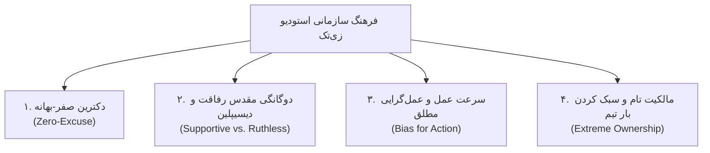

# منشور فرهنگ سازمانی، ارزش‌های بنیادین و استانداردهای عملکردی
## استودیو و آژانس مهندسی وب و هوش مصنوعی حسن شاهمرادی (مستقر در مرکز نوآوری زی‌تک)

> **«در این مجموعه کار نشدنی وجود ندارد. کارهایی که انجام می‌دهیم شکافتن اتم یا فیزیک کوانتوم نیست؛ سرچ در دنیای وب، کار با چند ابزار هوش مصنوعی، ارتباط موثر با انسان‌ها و اجرای متعهدانه است. اگر در کره زمین حتی یک نفر توانسته کاری را انجام دهد، پس این کار راه دارد و شدنی است.»**  
> — *حسن شاهمرادی*

---

## ۱. فلسفه وجودی و چرایی تدوین این منشور

این سند، سنگ بنای فرهنگ سازمانی، هویت رفتاری و استاندارد کیفی تیمی است که در حال ساخت آن هستیم. فرقی نمی‌کند در چه جایگاهی مشغول به کار باشید — چه به عنوان **شکارچی لید و کارشناس فروش**، چه به عنوان **طراح رابط کاربری (UI/UX)**، چه به عنوان **مهندس فرانت‌اند و وایب‌کودر** و چه به عنوان **مدیر تولید محتوا و تدوین‌گر** — این منشور، قرارداد فرهنگی نانوشته اما ۱۰۰٪ الزام‌آور میان شما و بنیان‌گذاران است.

ما یک اداره کارمندی با فرهنگ رخوت، بوروکراسی فرساینده، غر زدن و توجیه شکست‌ها نیستیم. ما یک تیم جنگنده، نخبه، سیستم‌محور و به شدت بلندپروازیم که می‌خواهیم بالاترین استاندارد مهندسی وب، سیستم‌سازی و بازاریابی مدرن را با اتکا به هوش مصنوعی پیاده‌سازی کنیم. 

حضور در این تیم نیازمند انطباق کامل با این اصول است؛ کسی که این فرهنگ را بپذیرد، سریع‌ترین رشد مهارتی و درآمدی زندگی شغلی خود را تجربه خواهد کرد.

---

## ۲. اصول طلایی ۴ گانه فرهنگ سازمانی



---

### اصل اول: دکترین صفر-بهانه (Zero-Excuse Resourcefulness)

#### ۱.۱. کلمات و الگوهای ممنوعه در تیم
در فرهنگ کاری ما، کلمات و عبارت‌های زیر جزو «واژه‌های سمّی و خط قرمز قطعی» هستند و به کار بردن آن‌ها نشان‌دهنده بن‌بست ذهنی و ناتوانی است:
* ❌ *«نشد!»*
* ❌ *«نمی‌تونم!»*
* ❌ *«بلد نیستم!»*
* ❌ *«به من نگفته بودید!»*
* ❌ *«یادم رفت!»*
* ❌ *«سعی خودم رو کردم ولی جوابی نگرفتم!»*

#### ۱.۲. قاعده طلایی ۳ راه‌حل (The Rule of 3 Solutions)
هر انسانی ممکن است در مسیر انجام کارهای جدید با ابهام، مانع فنی یا خطای ناشناخته مواجه شود. این کاملاً طبیعی است. اما نحوه مواجهه با این مانع است که عیار حرفه‌ای فرد را مشخص می‌کند:
* **رفتار آماتور:** به محض رسیدن به اولین مانع، کار را رها می‌کند، نزد بنیان‌گذار می‌آید و می‌گوید: *«فلان کار نشد، چی کار کنم؟»* (این رفتار یعنی انتقال بار روانی به مدیریت).
* **رفتار نخبه استودیو:** مانع را تحلیل می‌کند، در گوگل و یوتیوب سرچ می‌کند، از ChatGPT یا Claude راهکار می‌خواهد، گزینه‌ها را ارزیابی می‌کند، و هنگام مراجعه به بنیان‌گذار می‌گوید:  
  > **«من با این چالش مواجه شدم؛ ریسرچ کردم و این ۳ راهکار مشخص رو پیدا کردم. به نظر من گزینه دوم سریع‌تر به نتیجه می‌رسه؛ شما نظرتون چیه تا اجراش کنم؟»**

---

### اصل دوم: دوگانگی مقدس: «بیشترین رفاقت و احترام انسانی در کنار سخت‌ترین دیسیپلین خروجی»

تیم ما بر اساس یک دوگانگی ظاهراً متناقض اما به شدت قدرتمند بنا شده است:

```
┌───────────────────────────────────────────────┐
│              محیط کاری استودیو                │
├───────────────────────┬───────────────────────┤
│  سمت رفاقت و توسعه    │  سمت دیسیپلین خروجی   │
│                       │                       │
│ • بالاترین احترام     │ • تحمل صفر در برابر   │
│   انسانی و امنیت روانی│   تنبلی و اهمال‌کاری   │
│ • اشتراک بهترین ابزارها│ • پایبندی بی‌رحمانه به │
│   و اکانت‌های AI      │   ددلاین‌ها           │
│ • پاداش‌ها و درصدهای   │ • فیلتر خروج فوری برای│
│   سخاوتمندانه از درآمد│   افراد وابسته و منجمد│
│ • آموزش و یادگیری     │ • سنجش افراد صرفاً بر │
│   مداوم در کلاس جهانی │   پایه اعداد و نتایج  │
└───────────────────────┴───────────────────────┘
```

* **ما به خروجی پاداش می‌دهیم، نه تلاش بی‌نتیجه:** زحمت کشیدن بدون رسیدن به هدف برای هیچ کسب‌وکاری ارزش خلق نمی‌کند. ما عاشق تلاش هوشمندانه هستیم که به نتیجه ملموس (لید واقعی، کد تمیز، رضایت کارفرما، درآمد نقد) ختم شود.
* **رفاقت مانع رک‌گویی نیست:** ما تعارف و چاپلوسی نداریم. فیدبک‌ها شفاف، مستقیم، فوری و کاملاً متمرکز بر کیفیت کار هستند. هیچ فیدبکی شخصی نیست؛ بلکه تلاشی جمعی برای رساندن خروجی به سطح ۱٪ برتر بازار است.

---

### اصل سوم: سرعت عمل و گرایش به اقدام (Bias for Action & Velocity)

* **دشمن اصلی ما کمال‌گرایی کاذب است:** منتظر نماندن برای شرایط بی‌نقص؛ شروع کردن با امکانات موجود و اصلاح در مسیر حرکت (Iterative Perfection).
* **قانون ۲۰/۸۰ در اجرا:** ۸۰٪ نتیجه در ۲۰٪ اقدامات اولیه و متمرکز نهفته است. ساعت‌ها اتلاف وقت برای جزییات تزئینی که تاثیری در تجربه کارفرما یا عملکرد سیستم ندارد، اتلاف منابع است.
* **سرعت در پاسخگویی (High Responsiveness):** در دنیای بیزینس امروز، کسی برنده است که سریع‌تر پیام را بخواند، سریع‌تر لید را پاسخ دهد و سریع‌تر تسک را دلیور کند. سرعت بالا، احترام به وقت دیگران و نشانه حرفه‌ای بودن است.

---

### اصل چهارم: مالکیت تام و سبک کردن بار تیم (Extreme Ownership & Friction Reduction)

* **مالکیت ۱۰۰ درصدی تسک:** وقتی تسکی به شما سپرده می‌شود، شما مالک تام آن از صفر تا صد هستید. وظیفه شما پیگیری است تا زمانی که خروجی نهایی تایید و ثبت شود. گفتن این که *«من به فلانی پیام دادم ولی اون جواب نداد»* به معنای سلب مالکیت است و پذیرفته نیست.
* **فلسفه سبک کردن بار بنیان‌گذاران:** هدف از اضافه شدن هر عضو جدید به تیم، **کاستن از بار فکری، اجرایی و ارتباطی بنیان‌گذاران** است، نه اضافه کردن دغدغه جدید. اگر کاری به شما سپرده شد و مجدداً بنیان‌گذار ناچار شد خودش پیگیری کند، حضور آن جایگاه توجیهی ندارد.
* **محافظت از تمرکز فنی تیم (Flow State Protection):** برنامه‌نویسان و معماران سیستم در استودیو نیازمند ساعت‌ها تمرکز عمیق بدون وقفه هستند. وظیفه تیم فروش و اکانت منیجری، ایجاد سپر دفاعی در برابر تماس‌ها و پیام‌های پراکنده کارفرمایان است تا ذهن تیم فنی فقط روی خلق محصول خارق‌العاده متمرکز بماند.

---

## ۳. آداب و استانداردهای ارتباطی درون و برون‌سازمانی

### ۳.۱. قوانین ارتباط در تلگرام (قلمرو اصلی تعاملات)
1. **ارتباطات مکتوب و ساختاریافته:** پیام‌ها باید کوتاه، شفاف و با استفاده از بولت‌پوینت باشند. از ارسال پیام‌های تک‌کلمه‌ای پشت سر هم (اسپم) خودداری کنید.
2. **کپسوله‌سازی پیام‌ها:** به جای نوشتن «سلام»، منتظر ماندن برای جواب و سپس پرسیدن سوال، کل پیام خود را در یک پیام کامل بنویسید:
   - *سلام وقت بخیر. وضعیت تسک X: انجام شد و در پوشه Y قرار گرفت. نکته قابل تایید: لینک Z.*
3. **ویس‌های هدفمند:** ارسال ویس تنها در صورتی مجاز است که انتقال مفهوم به صورت متنی زمان‌بر باشد، و طول ویس نباید از ۶۰ الی ۹۰ ثانیه بیشتر شود. ویس‌های مبهم، پر از مکث و بدون مقدمه ممنوع است.

### ۳.۲. خطوط قرمز تماس تلفنی (No-Call Policy)
* **تماس تلفنی خط قرمز آرامش تیم است:** برای امور روزمره، گزارش‌ها و پیگیری‌ها هرگز با همکاران یا بنیان‌گذاران تماس تلفنی برقرار نکنید. پلتفرم ارتباطی رسمی، چت سازمانی تلگرام است.
* **شرایط استثنای تماس:** تنها در شرایط بحران واقعی (Down شدن سرور اصلی در زمان ترافیک، بروز فورس‌ماژور قانونی یا حادثه غیرقابل پیش‌بینی) تماس تلفنی مجاز است.

### ۳.۳. استانداردهای محیط فیزیکی دفتر کار (مرکز نوآوری زی‌تک)
* **پوشش و پرستیژ آراسته:** دفتر کار زی‌تک یک محیط نوآوری بین‌المللی و دانشگاهی است. حضور با پوشش شیک، تمیز و حرفه‌ای معرف برند استودیو است.
* **مدیریت نویز و صدا:** دفتر کار محیط تمرکز، کدنویسی و دیزاین است. مکالمات تلفنی با لیدها باید با صدای کنترل‌شده و در صورت طولانی شدن در فضاهای اشتراکی یا اتاق‌های اختصاصی تماس زی‌تک صورت گیرد.
* **نظم و آراستگی میز کار:** میز کار، ابزارها و تجهیزات تصویربرداری باید همیشه مرتب و آماده به کار باشند.

---

## ۴. چرخه شفافیت، سنجش عملکرد و فیلترهای خروج (Accountability)

| سطح عملکرد | وضعیت رفتاری | پیامد سازمانی |
| :--- | :--- | :--- |
| **سطح A (ستاره تیم)** | حل مسئله مستقل، آوردن ایده‌های نو، رسیدن به تارگت‌ها، انرژی مثبت و سرعت عمل بالا | پاداش‌های نقدی حداکثری، ارتقای درصد پورسانت، افزایش اختیارات، هدایای دوره‌ای |
| **سطح B (عملکرد استاندارد)** | اجرای بدون تاخیر تسک‌ها، رعایت فرهنگ صفر-بهانه، تعامل منظم و بدون حاشیه | دریافت کامل حقوق پایه و پورسانت مصوب، ثبات همکاری |
| **سطح C (هشدار و افت کیفیت)** | بهانه‌تراشی، تأخیر در پاسخگویی، ایجاد مزاحمت تلفنی برای تیم فنی، عدم ثبت گزارش‌ها | جلسه شفاف‌سازی مستقیم، اخطار اول و مهلت ۱۴ روزه جهت اصلاح کامل |
| **سطح D (فیلتر خروج قطعی)** | تکرار الگوهای «نشد/نمی‌تونم»، عدم صداقت در گزارش‌ها، رخوت، ایجاد بار منفی روانی در تیم | قطع فوری همکاری، تسویه‌حساب قانونی و جایگزینی بدون وقفه |

---

## ۵. تعهدنامه متقابل (The Mutual Pact)

* **تعهد استودیو به شما:** ما متعهد می‌شویم بهترین ابزارها، شفاف‌ترین مدل مالی، امن‌ترین محیط کاری، بالاترین احترام انسانی و سریع‌ترین مسیر رشد تخصصی را برای شما فراهم کنیم. ما به شما ماهی‌گیری در بالاترین سطح بازارهای دیجیتال را یاد خواهیم داد.
* **تعهد شما به استودیو:** شما متعهد می‌شوید انرژی کامل، صداقت بی‌قید و شرط، تعصب به کیفیت خروجی، روحیه کاوشگر و جنگنده و مسئولیت‌پذیری صددرصدی خود را پای کار بگذارید و به یکی از ستون‌های استوار رشد این برند تبدیل شوید.

---
*نسخه ۱.۰ — تدوین‌شده برای تمامی بخش‌ها و عناوین شغلی استودیو و آژانس مهندسی وب حسن شاهمرادی.*
