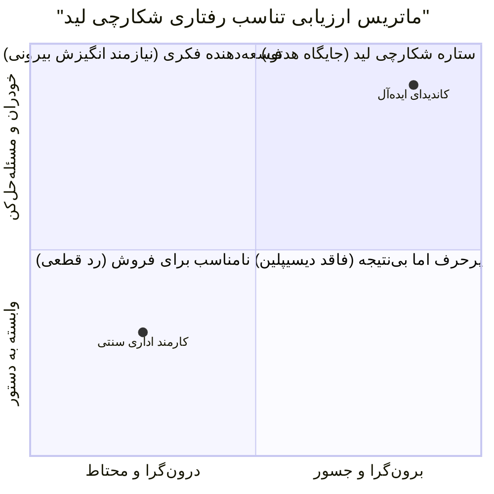
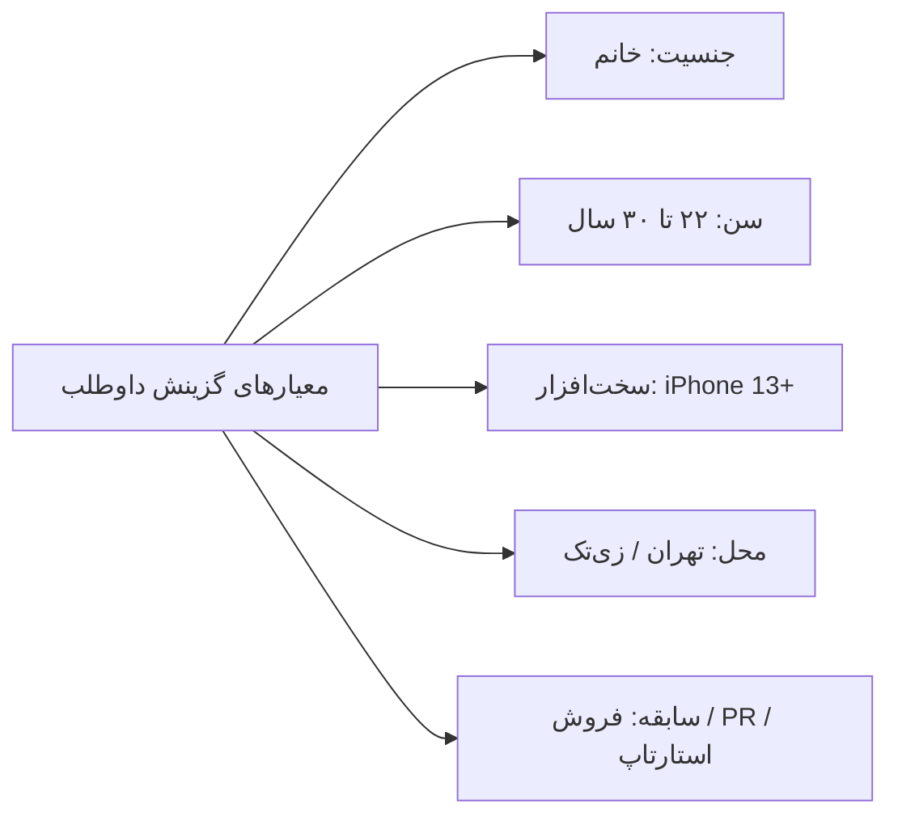

# شناسنامه و معماری جامع جایگاه شغلی
## کارشناس فروش، توسعه بازار و شکارچی لید (Lead Hunter & Brand Growth Specialist)
### دفتر کار: تهران، بلوار پژوهش، ساختمان رویش، مرکز نوآوری زی‌تک (ZTech)، واحد ۱۰۴

---

## ۱. هویت و فلسفه وجودی نقش (Role Identity & Mission)

این نقش، موتور محرکه درآمدی، خط مقدم ارتباطات و بازوی رشد تجاری استودیو و آژانس است. هدف غایی این جایگاه، فعال‌سازی پیوسته جریان لیدسازی، شکار فرصت‌های تجاری در بازار ایران و مارکت‌های بین‌المللی، مدیریت پرستیژ برند در شبکه‌های اجتماعی، و برگزاری جلسات رسمی فروش با بنیان‌گذاران است؛ به گونه‌ای که دغدغه جذب مشتری و تولید محتوای روزمره از دوش معماران فنی برداشته شود.

---

## ۲. ماتریس ۲۵ مؤلفه استاندارد معماری نقش (بر پایه متدولوژی SHRM و Korn Ferry)

| ردیف | مؤلفه استاندارد (Element) | وضعیت و تعریف اختصاصی در استودیو |
| :---: | :--- | :--- |
| **۱** | **عنوان رسمی شغلی** | کارشناس فروش و رشد برند (Sales & Brand Growth Specialist) |
| **۲** | **عنوان عملکردی تخصصی** | شکارچی لید و کارشناس ارتباط با مشتریان (Lead Hunter & Client Specialist) *(عنوان کارشناسی است)* |
| **۳** | **فلسفه وجودی نقش (Mission)** | به چرخش درآوردن پیوسته پایپ‌لاین فروش، شکار سرنخ‌های معتبر، ست کردن جلسات دمو با بنیان‌گذار، گشایش کانال‌های درآمد دلاری و مدیریت اکانت مشتریان |
| **۴** | **خط گزارش‌دهی مستقیم** | گزارش‌دهی مستقیم، بی‌واسطه و روزانه به بنیان‌گذار (حسن شاهمرادی) |
| **۵** | **نوع همکاری و محل استقرار** | **حضوری / هیبرید:** حضور منظم در دفتر کار استودیو (مرکز نوآوری زی‌تک، واحد ۱۰۴) جهت ضبط محتوا، جلسات هماهنگی + دورکاری هدفمند برای پیگیری لیدها و ریسرچ مارکت دلاری |
| **۶** | **جنسیت احرازکننده** | **خانم** (به دلیل کاریزمای ارتباطی، ظرافت در تعاملات کلامی، دقت و تاثیرگذاری در پرستیژ برند) |
| **۷** | **دامنه تصمیم‌گیری مستقل** | **پلکانی و مبتنی بر شایستگی (Adaptive Autonomy):** استقلال کامل در انتخاب روش‌های شکار لید و نگارش پیام‌های اولیه؛ تصمیم‌گیری‌های فنی و عقد قرارداد نهایی با بنیان‌گذار |
| **۸** | **مرز مذاکره و فروش** | کارشناس مسئول پرزنت اولیه، کشف نیاز و **نشاندن مشتری پشت میز جلسه** است؛ جلسه رسمی و امضای نهایی قرارداد توسط شخص بنیان‌گذار انجام می‌شود |
| **۹** | **خطوط قرمز و ارجاع فوری** | دادن هرگونه تعهد فنی خارج از چهارچوب؛ شکستن دیسیپلین تلگرام و زنگ زدن‌های مکرر به بنیان‌گذار؛ تخفیف‌دهی بدون هماهنگی؛ استفاده از ادبیات بهانه‌تراشانه («نشد، نمی‌تونم») |
| **۱۰** | **وزن‌دهی زمانی به وظایف (Time Split)** | • **۴۵٪:** شکار لید، پیام‌رسانی فعال (Cold/Warm Outreach)، ایجاد شبکه ارتباطی و ست کردن جلسات دمو<br>• **۳۰٪:** اکانت منیجری و پیگیری مشتریان در تلگرام، هماهنگی پرداخت اقساط، ریسرچ پلتفرم‌های دلاری<br>• **۲۵٪:** تصویربرداری با آیفون، سناریونویسی استوری با AI، آپلود منظم محتوا و چیدن برنامه‌های لایو |
| **۱۱** | **وظایف روتین روزمره** | پاسخ فوری به سرنخ‌ها، ثبت لید در تسک‌منیجر، ضبط ویدیوها و استوری‌های روزمره محیط کار، بارگذاری پست‌های تدوین‌شده، ارسال پیام‌های هدفمند به کسب‌وکارهای متقاضی |
| **۱۲** | **وظایف دوره‌ای (هفتگی/ماهانه)** | ارائه گزارش آماری هفتگی به بنیان‌گذار (تعداد لید، جلسات برگزار شده، قراردادهای بسته شده)، برگزاری لایوهای اینستاگرامی، پیگیری فاکتورهای ماهانه سئو |
| **۱۳** | **شاخص‌های فعالیت ورودی (Input KPIs)** | ارسال مداوم پیام‌های ارتباطی به برندها، ست کردن حداقل ۳ الی ۵ جلسه دموی باکیفیت در هفته با بنیان‌گذار، نظم ۱۰۰٪ در انتشار استوری‌های روزانه |
| **۱۴** | **شاخص‌های خروجی و مالی (Output KPIs)** | بستن حداقل ۲ الی ۳ قرارداد نهایی وب در ماه، رساندن اولین مشتری دلاری به قرارداد در پایان ماه دوم، تمدید ۱۰۰٪ مشتریان ماهانه سئو |
| **۱۵** | **نقشه راه ۹۰ روز اول (30-60-90)** | • **ماه اول:** تسلط بر ادبیات فنی و کاتالوگ خدمات، شروع تصویربرداری و استوری‌ها، ستاپ پلتفرم‌های دلاری، ورود پایدار لید<br>• **ماه دوم:** تسلط بر مدیریت مشتریان در تلگرام، ثبت حداقل ۲ قرارداد بسته شده، اولین ارسال پروپوزال دلاری<br>• **ماه سوم:** خودرانی کامل، ثبات در ورودی لید، صفر کردن اصطکاک‌های ارتباطی بنیان‌گذار |
| **۱۶** | **دانش تخصصی مورد نیاز** | درک کلی از طراحی وب، سئو، هوش مصنوعی، و تسلط به کار با ChatGPT جهت ایده‌پردازی و تدوین پیام‌ها |
| **۱۷** | **مهارت‌های سخت الزامی** | تصویربرداری باکیفیت با آیفون، کاربری مسلط در تلگرام، اینستاگرام، لینکدین و سایت‌های فریلنسری بین‌المللی (Upwork, Freelancer) *(توجه: ادیت پست‌ها با بنیان‌گذار است)* |
| **۱۸** | **روحیات بنیادین و منشور اخلاقی** | انطباق کامل با [منشور فرهنگ سازمانی (CULTURE_AND_STANDARDS.md)](file:///Users/infinite/HasanShah/careers/CULTURE_AND_STANDARDS.md)؛ روحیه کاشف و حل مسئله صفر-بهانه؛ تاب‌آوری روانی بالا |
| **۱۹** | **تسلط زبانی و بین‌المللی** | زبان انگلیسی در حد درک مطلب و مکاتبه متنی روان جهت جستجوی پروژه‌ها و ارتباط با کارفرمایان بین‌المللی |
| **۲۰** | **سخت‌افزار الزامی متقاضی** | **داشتن گوشی هوشمند شخصی iPhone 13 به بالا (الزامی)** با لنز کاملاً سالم جهت ضبط ویدیوها و استوری‌های استودیو |
| **۲۱** | **ابزارهای اهدایی استودیو** | دسترسی کامل به اشتراک‌های هوش مصنوعی (ChatGPT Plus)، اپلیکیشن مدیریت لیدها، خطوط ارتباطی سازمانی |
| **۲۲** | **حقوق پایه ماهانه** | **۱۵,۰۰۰,۰۰۰ تومان** (در صورت بستن حداقل ۱ قرارداد در ماه، ارتقای فوری به **۲۰,۰۰۰,۰۰۰ تومان**) |
| **۲۳** | **کمیسیون قراردادهای وب و اپ** | **پلکانی عملکردی:** ۱ قرارداد: **۱۰٪** | ۲ تا ۴ قرارداد: **۱۵٪** | ۵ قرارداد به بالا: **۲۰٪** (میانگین هر پروژه: ۱۰۰ م) |
| **۲۴** | **کمیسیون خدمات مستمر سئو** | **ماه اول هر قرارداد: ۱۵٪** | **ماه‌های تمدید بعدی: ۵٪ مستمر** (تعرفه ماهانه سئو: ۵۰ م) |
| **۲۵** | **کمیسیون قراردادهای ارزی (دلاری)** | **پلکانی دلاری با نرخ مصوب ۲۷۰,۰۰۰ تومانی:** ۱ پروژه: **۲۰٪** (۸۱ م) | ۲ تا ۵ پروژه: **۲۵٪** (۱۰۱.۲ م) | ۶ پروژه به بالا: **۳۰٪** (۱۲۱.۵ م) *(مبنا: پروژه ۱۵۰۰ دلاری = ۴۰۵ م)* |

---

## ۳. جدول پروفایل شخصیتی، رفتاری و تیپولوژی (Personality & Behavioral Profile)



| مؤلفه ارزیابی | ویژگی‌های مطلوب و هدف | علائم هشداردهنده (Red Flags) |
| :--- | :--- | :--- |
| **تیپ‌های شخصیتی ایده‌آل (MBTI)** | **ENFP / ENTP / ESTP / ENTJ:** برون‌گرا، پرانرژی، کنجکاو، خوش‌صحبت، دارای هوش کلامی بالا و انگیزه مادی شدید | تیپ‌های به شدت درون‌گرا (ISFJ/INTP) که از پیام دادن به غریبه‌ها یا قرار گرفتن در مرکز توجه فراری هستند |
| **تاب‌آوری در برابر ریجکت (Rejection Resilience)** | درک این که جواب «نه» از سمت مشتری، یک مسئله شخصی نیست؛ بلکه بخشی از قیف فروش است. شنیدن ۱۰ پاسخ منفی انگیزه او را برای یافتن پاسخ مثبت بعدی کم نمی‌کند. | فرد با اولین بی‌محلی یا جواب سرد مشتری سرخورده شود، احساس شکست کند و دست از تلاش بکشد. |
| **پیگیری مستمر اما باوقار (Dignified Persistence)** | پیگیری هوشمندانه با خلق ارزش؛ ارسال سرنخ‌ها، نمونه‌کارها و یادآوری مؤدبانه بدون افتادن در ورطه التماس یا مزاحمت بازاریابی. | تماس‌های مکرر آزاردهنده، لحن طلبکارانه یا رها کردن لید پس از یک بار پیام دادن. |
| **استقلال و خودرانی (Self-Driven Drive)** | برای شروع کار منتظر چک‌لیست صبحگاهی بنیان‌گذار نمی‌ماند؛ خودش لیست برندها را استخراج می‌کند، به سراغ پلتفرم‌ها می‌رود و ایده‌های جدید می‌آورد. | منتظر نشستن تا کارفرما به او دیکته کند چه متنی بنویسد یا به چه کسی پیام دهد. |
| **انگیزه شدید مالی و رشد شخصی** | عطش واقعی برای کسب درآمدهای بالا (پورسانت‌های چند ده میلیونی و دلاری)؛ باور به این که سقف درآمدی او دست خودش است. | رضایت دادن به حداقل حقوق کارمندی، نداشتن اشتیاق برای بستن قراردادهای بیشتر. |

---

## ۴. جدول هوش هیجانی و روان‌شناختی (EQ & Emotional Intelligence)

| شایستگی روان‌شناختی | تعریف کاربردی در صحنه فروش استودیو | نحوه ارزیابی و بروز در کار |
| :--- | :--- | :--- |
| **گوش دادن فعال و همدلی تجاری** | توانایی درک درد واقعی کارفرما (مثلاً: «سایتم فروشی نداره»، «برندم دیده نمیشه»، «از طراح قبلی ضربه خوردم») به جای حفظ کردن متن فروش. | تکرار و بازتاب دادن دغدغه مشتری در مکالمه و نشان دادن اینکه ما مشکل او را عمیقاً فهمیده‌ایم. |
| **حس ششم تشخیص کیفیت لید (Lead Qualification)** | غربالگری سریع کارفرمایان واقعی و دست‌به‌نقد از افراد کنجکاو، تخفیف‌جو یا اتلاف‌کننده وقت (Time-Wasters). | هدایت هوشمندانه مشتریان باارزش به جلسه دمو، و مؤدبانه رد کردن افرادی که بودجه یا قصد جدی ندارند. |
| **کنترل احساسات و ثبات روانی** | حفظ آرامش کامل در زمان مواجهه با اعتراض کارفرما، چانه‌زنی‌های تند، یا تغییر لحن مخاطب؛ عدم عصبانیت و عدم تدافعی شدن. | پاسخ‌دهی منطقی و محکم با استناد به ارزش و خروجی‌های پورتفولیو بدون افتادن در دام کل‌کل یا باج‌دهی احساسی. |
| **تنظیم فاصله اجتماعی و پرستیژ برند** | حفظ مرز باریک میان صمیمیت دوستانه و احترام حرفه‌ای؛ ایجاد این باور در ذهن کارفرما که با یک استودیوی طراز اول و گران‌قیمت طرف است. | پرهیز از شوخی‌های جلف یا لحن شکسته و لاتی در چت؛ استفاده از واژگان رسمی، فاخر و محترمانه در عین پرانرژی بودن. |

---

## ۵. ماتریس مهارت‌های سخت و نرم (Hard & Soft Skills Matrix)

| دسته‌بندی | عنوان مهارت | سطح مورد انتظار | ابزارها و کاربرد عملیاتی |
| :--- | :--- | :---: | :--- |
| **مهارت سخت** | **پرامپت‌نویسی و کار با AI** | پیشرفته | کار با ChatGPT جهت نگارش متون استوری، ایمیل‌های سرد، ایده‌پردازی سناریوهای معرفی خدمات |
| **مهارت سخت** | **تصویربرداری تمیز با موبایل** | متوسط به بالا | تسلط بر کادربندی، نورسنجی، ثبات دست و ضبط ویدیوهای شفاف با iPhone 13 به بالا |
| **مهارت سخت** | **پلتفرم‌های ارتباطی و شبکه‌های اجتماعی** | پیشرفته | مدیریت دایرکت و استوری‌های اینستاگرام، گروه‌های کاری تلگرام، لینکدین و اکسپلور |
| **مهارت سخت** | **کاربری پلتفرم‌های بین‌المللی** | متوسط | سرچ، ایجاد پروفایل، ارسال پیشنهاد در Upwork، Freelancer و لینکدین بین‌الملل |
| **مهارت سخت** | **مدیریت تسک و لید** | متوسط | کار با سیستم مدیریت پروژه (تسک‌منیجر استودیو) و ثبت دقیق وضعیت مکالمات |
| **مهارت نرم** | **مذاکره اقناعی و فن بیان** | پیشرفته | انتقال هیجان و اطمینان در صدای ویس‌ها، توانایی متقاعدسازی برای ورود به جلسه |
| **مهارت نرم** | **کپی‌رایتینگ ترغیب‌کننده** | متوسط به بالا | نوشتن متن‌های کوتاه، خوش‌خوان و ضربتی که خواننده را وادار به پاسخ دادن کند |
| **مهارت نرم** | **سبک‌سازی بار بنیان‌گذار** | حیاتی | بستن تمام سوالات پیش‌پاافتاده کارفرما در تلگرام و نفرستادن آن‌ها سمت برنامه‌نویس |
| **مهارت نرم** | **مدیریت زمان و چابکی** | پیشرفته | رساندن بدون تاخیر استوری‌ها در ساعات اوج بازدید، پاسخگویی به لیدها زیر ۱۵ دقیقه |

---

## ۶. استانداردها و اصول کلامی، لحن و فنون مذاکره (Verbal & Communication Etiquette)

### ۶.۱. قانون طلایی پاسخ به قیمت در تلگرام
بزرگ‌ترین اشتباه بازاریاب‌های آماتور، پرتاب کردن رقم قیمت در همان ثانیه‌های اول است. فرمول ارتباطی استاندارد ما:

```
┌──────────────────────────────────────────────────────────────┐
│                    فرمول ۳ مرحله‌ای پاسخ به قیمت              │
├──────────────────────────────────────────────────────────────┤
│ ۱. تایید هوشمندانه: درک نیاز و بزرگی پروژه مشتری             │
│ ۲. ایجاد تمایز لوکس: توضیح اینکه کار ما قالب آماده نیست      │
│ ۳. رزرو دمو: «برای اینکه رقم دقیق متناسب با هدف برندتون      │
│    محاسبه بشه، یک جلسه دموی کوتاه ۱۰ دقیقه‌ای با مهندس       │
│    شاهمرادی ست می‌کنیم تا نقشه راه و بودجه رو بررسی کنیم.»  │
└──────────────────────────────────────────────────────────────┘
```

### ۶.۲. نمونه اسکریپت‌های کلامی آماده

#### سناریوی الف: مشتری در دایرکت/تلگرام می‌پرسد: «هزینه طراحی سایت چقدره؟»
* **پاسخ غلط:** *«سلام، از ۵۰ میلیون شروع میشه تا ۱۲۰ میلیون.»* (مشتری فرار می‌کند چون ارزشی ندیده است).
* **پاسخ حرفه‌ای شکارچی لید:**  
  > *«درود بر شما وقتتون بخیر 🌱  
  > در استودیوی ما تمام سیستم‌ها به صورت اختصاصی، مهندسی‌شده و با آخرین استانداردهای هوش مصنوعی و کدنویسی روز دنیا توسعه پیدا می‌کنند و ما به هیچ وجه از قالب‌های آماده یا پلتفرم‌های کند استفاده نمی‌کنیم.  
  > برای اینکه دقیقاً بررسی کنیم چه معماری و راهکاری بیشترین فروش و اعتبار رو برای برند شما خلق می‌کنه، پیشنهاد می‌کنم یک جلسه آنلاین کوتاه با مهندس شاهمرادی داشته باشید تا نقشه راه فنی و پلن سرمایه‌گذاری رو با هم مرور کنید.  
  > فردا عصر ساعت ۱۷ براتون مناسب‌تره یا ۱۸:۳۰؟»*

#### سناریوی ب: درخواست تخفیف کارفرما
* **پاسخ حرفه‌ای شکارچی لید:**  
  > *«کاملاً متوجه دغدغه شما در مدیریت هزینه‌ها هستم؛ اما در استودیوی مهندس شاهمرادی کیفیت، سرعت لود زیر ۱ ثانیه و پشتیبانی بی‌نقص اولویت اوله و ما هرگز کیفیت رو فدای تخفیف نمی‌کنیم. به جای تخفیف، می‌تونیم روی مدل پرداخت اقساطی متناسب با پیشرفت پروژه باهاتون همراهی کنیم.»*

---

## ۷. مشخصات دموگرافیک، سن، پیش‌زمینه و نیازمندی‌های سخت‌افزاری



1. **جنسیت:** **خانم** (قطعی و غیرقابل تغییر).
2. **رده سنی:** **۲۲ تا ۳۰ سال** (مقطع سنی ایده‌آل؛ پر از انرژی، اشتیاق به یادگیری، منعطف و بدون دغدغه‌های روزمره فرساینده).
3. **محل سکونت و تردد:** ساکن تهران با دسترسی آسان به مرکز نوآوری زی‌تک (منطقه ۲۲، بلوار پژوهش).
4. **پیش‌زمینه کاری مطلوب:**
   - تجربه موفق در پذیرش یا روابط عمومی کلینیک‌های زیبایی و مراکز لوکس.
   - سابقه در فروش تلفنی و برقراری ارتباط موثر در شرکت‌های نوآور و استارتاپی.
   - فعالیت به عنوان ادمین یا تولیدکننده محتوا در پیج‌های بیزینسی پرمخاطب.
5. **سخت‌افزار الزامی متعلق به متقاضی:**
   - **گوشی هوشمند شخصاً متعلق به فرد: iPhone 13، 13 Pro، 14، 15 یا مدل‌های بالاتر با سلامت فیزیکی لنزها.**

---

## ۸. بسته مالی، کمیسیون‌های پلکانی و جدول پیش‌بینی درآمد کارشناس

### ۸.۱. ساختار حقوق پایه و کمیسیون‌های پلکانی
* **حقوق پایه ماهانه:**
  * **ماه بدون قرارداد:** **۱۵,۰۰۰,۰۰۰ تومان** تضمینی.
  * **با بستن حداقل ۱ قرارداد در ماه:** **۲۰,۰۰۰,۰۰۰ تومان** (۵ میلیون پاداش مستقیم روی پایه).
* **کمیسیون قراردادهای وب و اپلیکیشن (میانگین هر قرارداد ۱۰۰ میلیون تومان):**
  * ۱ قرارداد در ماه: **۱۰٪** (۱۰ میلیون تومان پورسانت)
  * ۲ تا ۴ قرارداد در ماه: **۱۵٪** (۱۵ میلیون تومان به ازای هر پروژه)
  * ۵ قرارداد به بالا در ماه: **۲۰٪** (۲۰ میلیون تومان به ازای هر پروژه)
* **کمیسیون خدمات سئو (تعرفه ماهانه ۵۰ میلیون تومان):**
  * ماه اول هر مشتری سئو: **۱۵٪** (۷.۵ میلیون تومان پورسانت نقد)
  * ماه‌های تمدید بعدی: **۵٪ مستمر** (۲.۵ میلیون تومان درآمد ماهانه غیرفعال به ازای هر مشتری)
* **کمیسیون پروژه‌های ارزی / دلاری (۱۵۰۰ دلار با نرخ ۲۷۰,۰۰۰ تومان = ۴۰۵,۰۰۰,۰۰۰ تومان):**
  * ۱ پروژه در ماه: **۲۰٪** (**۸۱,۰۰۰,۰۰۰ تومان پورسانت نقد**)
  * ۲ تا ۵ پروژه در ماه: **۲۵٪** (**۱۰۱,۲۵۰,۰۰۰ تومان به ازای هر پروژه**)
  * ۶ پروژه به بالا: **۳۰٪** (**۱۲۱,۵۰۰,۰۰۰ تومان به ازای هر پروژه**)

---

### ۸.۲. جدول پیش‌بینی درآمد ماهانه و ۶ ماهه شکارچی لید (در ۴ سناریو)

| سناریوی عملکردی | حجم قرارداد در ماه | دریافتی ماهانه هانتر (پایه + پورسانت) | مجموع درآمد ۶ ماهه |
| :--- | :--- | :---: | :---: |
| **۱. فاجعه‌بار (بدون قرارداد)** | ۰ قرارداد | **۱۵,۰۰۰,۰۰۰ تومان** (فقط پایه) | ۹۰,۰۰۰,۰۰۰ تومان (قطع در ماه ۲) |
| **۲. محافظه‌کارانه (حداقل حیات)** | ۱ وب در ماه + ۱ سئو هر ۲ ماه | **۳۰ الی ۴۲.۵ میلیون تومان** | **۲۱۷,۵۰۰,۰۰۰ تومان** |
| **۳. هدف (عملکرد مورد انتظار)** | ۲ وب در ماه + ۱ سئو در ماه + ۲ دلاری | **۵۷.۵ الی ۱۴۸.۵ میلیون تومان** | **۵۴۴,۵۰۰,۰۰۰ تومان** |
| **۴. رویایی (جهش فوق‌العاده)** | ۳ تا ۵ وب در ماه + سئوی سازمانی + ارزی مداوم | **۱۵۰ الی ۲۰۰+ میلیون تومان** | **۱,۰۰۰,۰۰۰,۰۰۰+ تومان** |

> [!TIP]
> **شفافیت حداکثری درآمدی:** کارشناس فروش در این مجموعه دقیقاً می‌داند که با تلاش هدفمند، درآمد ماهانه‌اش می‌تواند از ۳۰ میلیون تا بالای ۱۰۰ میلیون تومان در ماه ارتقا یابد و سقف درآمدی به عملکرد خود او وابسته است.

---

### ۸.۳. قرارداد محرمانگی (NDA)
امضای قرارداد محرمانگی رسمی پیش از شروع به کار الزامی است (حفظ اطلاعات مشتریان، تعرفه‌ها و اسناد استودیو).

---

## ۹. فرآیند ثبت درخواست و مصاحبه استخدامی

متقاضیان باید مراحل زیر را طی کنند:
1. مشاهده لندینگ رسمی استخدام: `https://hasanshah.ir/careers/`
2. **ضبط ویدیوی سلفی ۳۰ ثانیه‌ای با آیفون خود:** معرفی کوتاه، بیان سوابق، و پاسخ به این سوال: *«اگر در مسیر یک تسک با مانع نشدن روبه‌رو بشید، دقیقاً چه رفتاری نشون می‌دید؟»*
3. ارسال ویدیو و رزومه در تلگرام به آیدی: `@shahbusinessman`
4. مصاحبه حضوری در دفتر کار استودیو واقع در مرکز نوآوری زی‌تک.

---
*سند معماری جایگاه شغلی — نسخه ۲.۰ ماژولار استودیو حسن شاهمرادی.*

